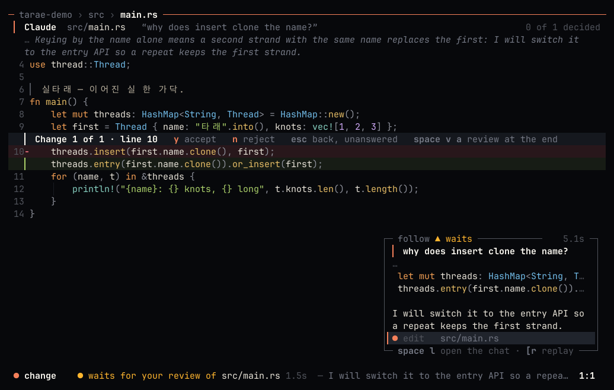
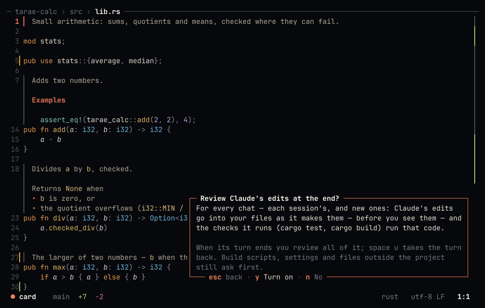
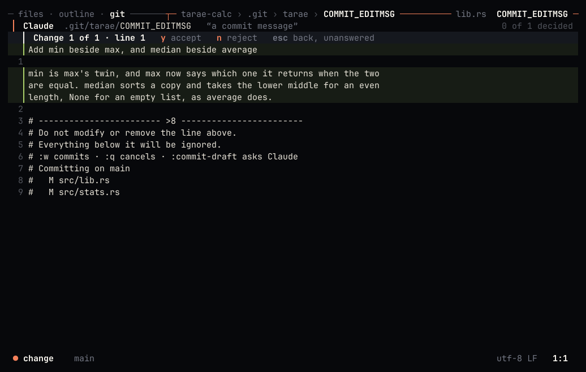
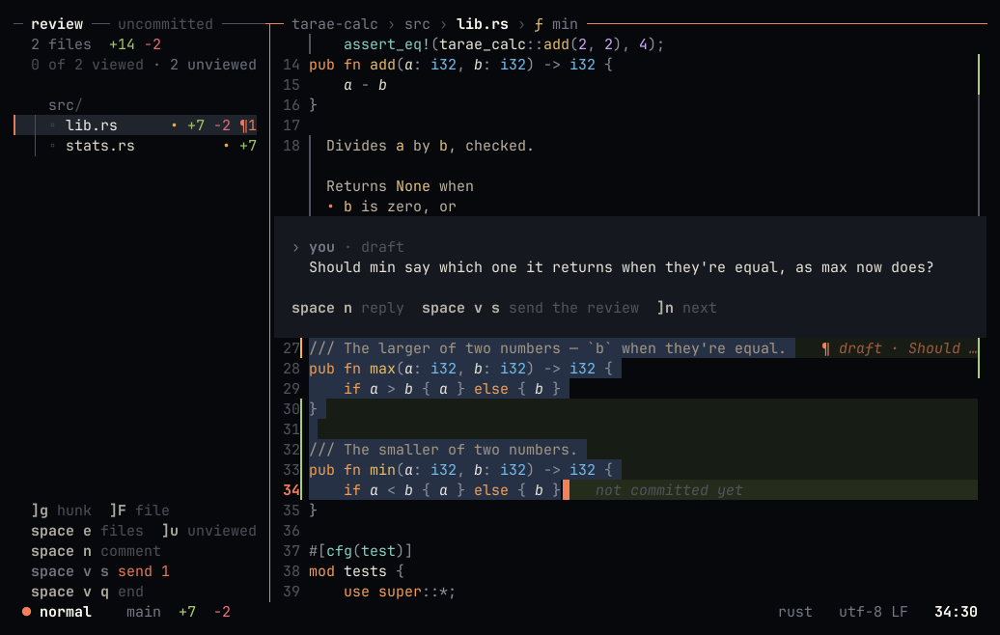
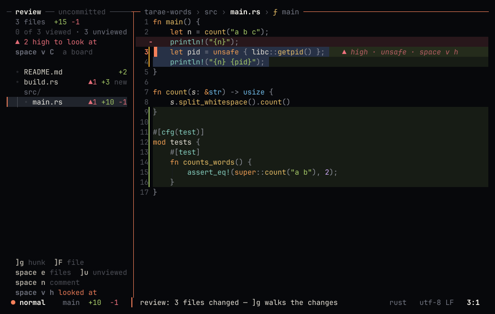
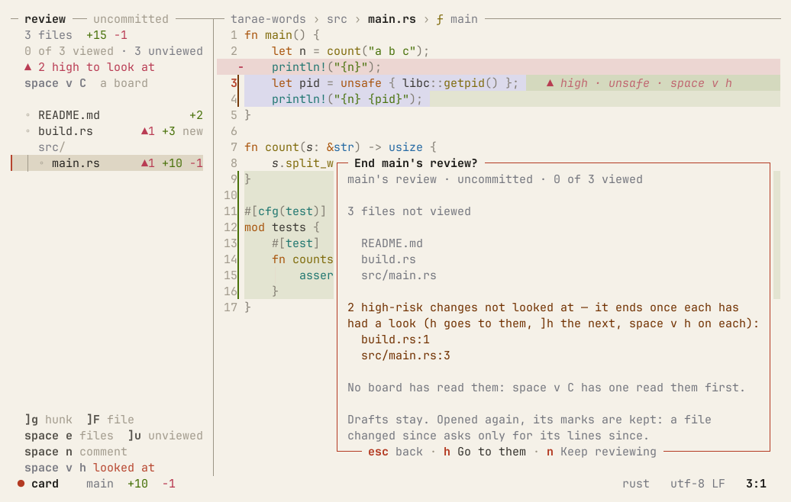

# Claude

tarae works with Claude inside the editor: edit a selection, or chat in a side panel where Claude reads, runs and
edits the project with you watching and answering.

tarae runs the `claude` CLI as a subprocess — there's no HTTP client, SDK, or API key in the editor; it uses your
Claude Code login as it is. You need [Claude Code](https://claude.com/claude-code) installed and
logged in — where `claude` isn't found, the chat says how to install it and log in, as Claude Code's own setup
docs do.

tarae uses your Claude Code folder and login as they are, on macOS and Linux. Claude's commands run in a sandbox
and its edits come to you for review; the claude program itself runs in a sandbox of its own too (Seatbelt on
macOS; Landlock and a seccomp filter on Linux). On Linux that sandbox leaves your `~/.claude` to it whole — claude
refreshes your login there, and Landlock can only grant the folder with all below it — so there it could write
your Claude Code's settings, hooks and `CLAUDE.md`, which macOS keeps from it.
[What it keeps](#the-claude-program-itself).

- [Select → instruct → diff](#select--instruct--diff)
- [Chat panel](#chat-panel) — [follow mode](#follow-mode), [the plan](#the-plan), [edits](#edits), [undoing a turn](#undoing-a-turn), [running the tests](#running-the-tests), [running commands](#running-commands), [notes](#notes)
- [Commit messages](#commit-messages)
- [Code review](#code-review)
- [Settings](#settings)

## Select → instruct → diff

In a selection-first editor, Claude takes the *action* slot: select, then tell it what to do.

1. Select one or more pieces of text (multiple cursors work — Claude answers for each selection)
2. `space i` (or `:ask <instruction>`) and type the instruction
3. The answer streams into a card at the bottom right (thinking/writing, elapsed time) while you keep editing
4. It opens as an **in-buffer review**: the whole file stays in view with only the changed spots expanded — deleted
   lines on faint red, added lines on faint green, both in the file's syntax colors, a header line per change

It's a Claude of its own, beside the chat: one turn of `claude -p` that starts at Enter, with no conversation
behind it and no settings, and only tarae's `read` and `edit` as tools. It gets your selections, quoted as
`space >` quotes them (each whole, with its file and lines), and your instruction. It may read around them, then
makes the change with `edit`, which you review as you review every edit of Claude's. It never waits behind a chat
turn, and the chat hears nothing of it: not in its conversation, its turn, or what it has read. It stops after 10
requests.

An accepted change is saved, as every change of Claude's is, unless the buffer has unsaved edits of yours (then it
stays in the buffer with them). A buffer that isn't a file of the project, such as a scratch buffer or a file
outside it, is named to this Claude by an id of its own (`buffer-…`, new each time). Its `edit` and `read` take
that id, and only this one buffer's. The change is reviewed in that buffer and not saved: `:w` saves it, as
always. Any path it names goes the way every edit's does, inside the project or refused. It reads nothing that would
ask you on a card, and no pages. What tarae shows read-only (a page, the woven view, a run's output) isn't
`space i`'s to change, and the status line says so. A file named like a key isn't sent, as `space >` doesn't send
one.

| Key | In the review |
|---|---|
| `y` / `n` | Accept / reject this change |
| `a` | Accept all |
| `q` | Reject the rest |
| `tab` | Next change |
| `j` / `k` | Scroll |

Accepted changes apply as one transaction — one `u` undoes them all. If the original text moved while you waited, it's
found again and the change still lands in the right place. `:ask-cancel` kills the process, so token generation stops
too ([screenshot](screenshots/m4-review.png)).

**What it costs**: measured on 2026-10-26 with five changes. `space i` cost $0.018 a change, with 2–3 requests and
the first change about 3.7 s after Enter. The chat cost $0.026 a change at a small context and $0.174 at a large
one (403k tokens), because each of its requests reads the whole conversation. `space i`'s cost doesn't grow with
the conversation, because it has none.

## Chat panel


`space l` (or `:chat [question]`) opens a panel on the right ([in hanji](screenshots/m4-chat-hanji.png)); `space L`
closes it and `:chat-new` starts over. One
process lives for the whole conversation, so Claude remembers what came before.

**What it's doing now** is on the status line, in every layout (the chat open, minimized into the follow card or
closed, following or not, a card up), right after the mode word (and after whose turn it is, where the status line
names the session):

```
● follow   ▸ running cargo test -q 41s — I will run the unit tests to check that nothing else relied…   › 3/4 Run the unit tests
```

First the step under way, with that step's own time (not the turn's): `▸ running cargo test -q`, `▸ queued 2nd · cargo
test -q`, `◦ reading src/chat.rs:120-180` (as the chat's row says it), `• searching fn draw_chat`, `• looking up Session`, `● writing
src/trust.rs` (an edit as it comes), `▸ asks to run …` or `● waits for your review of …` in the warning colour when it
waits on you, `◦ stuck? symbols 42s`, `▅ thinking` or `▅ writing` with the working sign. Then the last sentence
Claude finished, which is usually why: its thinking's summary until its words begin, in italic. It changes only as a
sentence ends, never with each word. Last comes the plan's step when Claude keeps a plan. When the line runs short the
plan's step goes first, then the sentence is cut. The mouse over the line shows all of it on a card above it; a press
on it follows Claude again (on, or back from a pause; `C-f` in the chat, `space F` in the code). None of it costs a
token: it's what Claude already sent. Drivers read it in the state as the session's `turn.now`.

**While it works** the chat's title (and the follow card's) says what the turn is at, in the same words as the status
line (`thinking 3.2s`, `writing`, `running`, `reading`), and whether anything is arriving. Before the word stands the
working sign: one cell in the accent, `▃` to `▆`, the same cell for the whole turn, so nothing beside it ever moves.
How it moves says what's happening. As Claude's words, its thinking's summary or an edit come in, its height is how
fast they come: high while they pour, lower as they thin, down at `▃` and still the moment they stop. Where nothing
streams by nature it breathes instead, an even rise and fall every two seconds: the turn's first seconds, Claude
thinking (its summary comes whole once it's done), the wait for its next answer after a tool's result went back, and a
run of Claude's. While the turn waits on you the cell is `▲`; a call that hangs makes it `◦`, with `stuck?` — where the
line already says so (the follow card's head, the chat's line with two sessions or more) the cell stays blank instead. Runs,
installs and a tab's badge use the same cell, breathing. At `editor.motion = "calm"` or `"none"` it holds `▄`.

**The model** is named in the chat's title while it's idle (`Opus 5.5 · high`). `C-t` in the chat (or `:model`,
or "Choose Claude's model" in the palette) lists the models your `claude` offers, with the one in use marked
([screenshot](screenshots/chat-model.png)). `:effort` sets how hard it thinks, for models that take it. The
choice applies to the conversation at once, with no restart and no lost context: the next answer comes from the
new model. It's also saved (`llm.model`, `llm.effort`), so `space i` and later chats use it too.

Conversations outlive tarae. Each one is kept for its project, and Claude keeps its own memory of it
(`claude --resume`). Open the chat after a restart and the latest conversation carries on (`continued from 2h
ago`) if you used it in the last 8 hours. Otherwise you get a fresh chat, and the empty panel lists your earlier
conversations. `C-p` in the chat (or `:chat-resume`) picks any of them, with the conversation as the preview
([screenshot](screenshots/chat-conversations.png)). The last 20 conversations of a project are kept, in
`~/.local/state/tarae/chats/`. Because Claude keeps the chat's conversations too, they also show in `claude --resume`
in that folder.

**When Claude compacts.** Near its context limit Claude Code summarizes the conversation so far and carries on
from the summary (or does it when you send `/compact`: typed, with or without its words, it goes as it is, without the
editor context tarae puts before a message — claude reads a command only at a message's start — and alone, what's
over the input staying there for your next message; any other `/…` you type is a message like the rest). Details it worked out before — a list it wrote, a plan's
steps — may survive only as far as the summary kept them. While it compacts, which can take a minute, the chat
(and the card beside the code, when following) says `compacting…` instead of `thinking…`. Then the chat says so
where it happened, a beat of its own between what came before and after: `≈ Claude compacted this conversation (automatic, 812k
tokens before) — what it worked out before may be only in its summary now` (`manual` when you asked). If Claude
later seems to have forgotten something, that note is why. When the chat is out of sight (the code zoomed with
`C-w z`, a review read wide), a toast says it too: `Claude compacted its conversation (automatic, 812k tokens
before) — space l shows it`, a warning when it came by itself. Minimized while following, the chat comes back
with the answer and the note in it, so no toast. The context figure under the chat drops to what the summary kept, and a `/compact` turn says
`compacted` where its token counts would be zeros (in `:usage` too). `tarae state` counts each session's
compactions, with the last one's time and trigger, and `--watch usage` is told when one happens.

**Idle compaction.** Claude's prompt cache lasts an hour after its last request. A message after that writes the
whole context to the cache again, at twice the input price, where a read costs a tenth. So, as Claude Code does in
the terminal, tarae compacts a big conversation you've left idle shortly before its cache expires: 54 minutes after
the last request (0.9 of the hour), when the context is 200k tokens or more, tarae sends `/compact` as a turn of its
own. The chat says why where it happens (`Idle 54m 0s — compacting before Claude's cache expires at 14:32 …`), and
the compaction's note says `idle`. Your next message then writes a summary to the cache, not the whole context.

It uses Claude Code's rule and your own settings, read where the chat's claude reads them: the Claude settings it
loads (yours, the project's, the local file, the managed one) and its environment. Before it fires, the chat's row
says when (`compacts 14:26`).

- `"idleCompaction": false` turns it off, and so does `"autoCompactEnabled": false`, `DISABLE_COMPACT` or
  `DISABLE_AUTO_COMPACT`.
- `CLAUDE_CODE_IDLE_COMPACT_MIN_TOKENS` changes the 200k minimum, never below 100k.
- It never compacts on the 5-minute cache, or while a turn, a queued message, a review, a card, a run, a rebase or a
  move onto the base waits.
- It never compacts while your plan's limit is close, or when tarae wakes more than a minute late (the machine was
  asleep).
- A message before the 54 minutes moves it to 54 minutes after that message's request.

In Claude Code itself this is behind a server-side switch. tarae's is on unless your settings turn it off.

Every message carries **the current file, cursor, selection, and diagnostics** as context, plus **what's on
screen**: the lines you're looking at, and the file in the pane beside it when the window is split. So "this" and
"here" mean what you see, even when the cursor is somewhere else — the whole file only the
first time a version is sent, and just the area around the cursor for files over 60 KB. What was sent shows as chips
above your message (`main.rs · L13–18 · 3 diagnostics`). Answers render as Markdown, with code blocks in their
language's colors.

When what you mean is somewhere else on the screen (a card, a panel, a message, the terminal's output), send the
screen with your message: `C-s` (below). Claude also knows [what's on screen by id](#whats-on-screen-by-id).

A card that asks something (a command to run, a read outside the project) takes the keys only once it's
focused. One that came on its own — Claude's, a server's, a sync's — waits in a faint frame wherever your keys are
(the code, the chat, a review), its way in the first pair of its bottom line — `╰─ C-q answer · y Once · n No ─╯`;
the status line says `▲1 waiting · C-q` (the chat's hints `C-q answer card`): a key typed for the code or a message
is never an answer. `C-q`, a click on it or `C-w w` (its last stop) focuses it — its frame lit, its answers in the
accent, `esc back` where `C-q answer` was (the answers stay where they were), the status line says `card`, your
draft stays as it was.

A card's keys are always on its bottom line, never in its body. Where they don't all fit there whole, the line gives
up what matters least first, in one order. Kept longest:

1. its way in, `C-q answer` (zellij's twin inside zellij) — without it nothing on the card says your keys don't
   answer it;
2. answers that last or can't be taken back, in their short words — each card kind marks them on its answers
   (`y Remove checkout`, `y Commit`, `y Stop it`, `y Bring`, a trust, a capital such as `N` never or `D` remove both,
   the `a`/`s` grants), and a cut card's `y once read` and `v read all`;
3. `space I list`, while other cards wait behind it;
4. the other answers' short words (`y move · c all · v files · n not now`), then their keys alone, the last first.

Past that, the card grows left over the code by just the cells its line needs, its corner where it was —
bottom-right, over the chat's foot or a docked list's, or above the status line: asks never go anywhere else. Only a
screen too narrow even for that draws no card; the status line says the width it needs (`▲1 waiting · card needs N
cols`). `C-q` still gives such a card the keys, but nothing answers a card nobody can see: every key is refused,
said on the status line (`y not taken — no room on screen for the card, the window needs to be wider`); `esc` gives
the keys back.

Over the chat's foot an ask's bottom line sits on the row right above the input's rule, no row of air between: the
rule is its edge, the input and its hint row untouched. Over a right-docked session list's foot (no input rule there)
and above the status line it keeps its row of air. On a screen the chat fills, a card focused from it stays where it
waited, over the chat's foot, the chat under it.

Esc goes back unanswered, and so does `C-w` (the window prefix going on from where you were). A card your own key asked for
(`:restart`, a new session, a bring) is focused as it comes. A focused card whose text changes (asked again, joined)
lets go of the keys: focus it again to answer what it says now. Esc never answers a card. `n` does. Answered, the
keys go on to the next card when you were going through them with `C-q` — once a frame has drawn it: a `y` typed on
before that (a repeat) is refused and said on it, never an answer to a card not yet in sight — else back where they were. A card counts what waits behind it — `1/3`: cards
under it, Claude's calls queued, cards in other sessions — and says it in words: `2 more wait — 1 here, 1 in
fix-login`, the key that lists them its bottom line's last pair (`space I list`) — the queue it counts is never
one with no way to it. A card cut
short says how much and whether it's read (`↓ 45 more lines, not read yet`); its bottom line has `v read all`, and
a yes that waits for it says `y once read` until it is.

Claude's calls made at once can stack cards asking for the very same run — the same command, character for
character, in the same folder, showing the same. The card in front lists those behind it — `+1 more like it: card#53 — same command, unchanged`
— and `Y` answers it and them, a `y` each (each its own `card` line). Only once the card in front has been in
sight whole and focused, as its `y` — a card joining the list after that makes it one to read again; never for a
card that warns of something, nor one past the sandbox (outside it, or with a socket) or with none around it (none
here, or `llm.sandbox` off). Any other card behind is answered on its own.

A card too tall for the screen is read whole in its own buffer (`v`), the card a bar over the status line that
says whose keys they are. The card keeps the keys while you read: `j`/`k`, `g e` and the page keys move through
the text, and its answers answer it. Esc gives them back to the code, and from then on `y` there is a yank, not a
yes. Only `C-q` gives them to the card again: pressed again it keeps them, and it never lets go.

**The inbox** is everything waiting for your answer, in every session, oldest first: Claude's run and read
cards, its edits waiting for their review (`Change 1 of 2 · src/a.rs` — a protected file like `.tarae.toml`
always asks), change sets, and tarae's own cards (trust, a rebase, a download). The status line counts them all
(`▲3 waiting`) once anything waits beyond the card in front of you. `space I` (`:inbox`, or a click on the
count) lists them: each row names its session, what it asks, its kind and how long it has waited. `enter` goes
to it. Its session comes to the front and its card comes up with the keys, and you answer it there, on the card.
The list never answers anything itself. `C-q` takes what waits in the session in front first, then follows
the list's order: it goes to the one that has waited longest, whichever session it's in, and that card comes up
with the keys, as with `enter` (a chat there that had them keeps what you typed). While anything waits, `C-q`
never says nothing does.

Two kinds of news are in the list too, after everything that asks for an answer: a run of Claude's that has
printed nothing for minutes (it may only be slow, and a card surely waits), and a reviewer that ended in a
session behind. They aren't counted in `▲3 waiting`, or in a card's `1/2 here · 1 elsewhere`. Quiet runs have
their own calm count on the status line (`1 run quiet`), since they can be in any session, the one in front
too. A reviewer's end is its session's `•` (on its tab, or in the status line's `•1` when the chat is closed),
the same mark that says its files came again from disk: something happened there while you were away.

**A run that looks stuck** gets a card of its own: when a run of Claude's has printed nothing *and* used next to
no CPU for `llm.stuck-after` minutes (10 by default; 0 = never), the card says `Stuck? … No output for 12 min,
0% CPU`. Before it shows, tarae reads what each of the run's threads is waiting in and puts it in the run's
output, so it's still there if you stop the run: on Linux each thread's state and kernel wait channel
(`/proc/<pid>/task/*/stat` and `wchan`), on macOS each thread's state (macOS doesn't tell an unprivileged
reader where a thread waits; `sample <pid>` in a terminal shows its stacks). Nothing needs root. `y` stops the
run (its panel and output stay, and Claude hears how it ended), `w` shows those lines in its panel, `n` keeps
waiting and asks again after as long again. If the run prints or ends, the card goes away.

**A run busy at something it doesn't show** — a `grep` with a runaway pattern, a loop — is never stuck: it uses
the CPU. Once it has printed nothing for ten minutes at half a core or more (no new process in its tree meanwhile,
no time limit of its own still to come), it's said, not asked: its panel and Claude's run row say `no output for
10:03 · 100% CPU`, the row with `space m c stop it`, and it joins the quiet runs (`1 run quiet`, the list's entry
ending `— space m c stops it`). Ten minutes is tarae's own longest quiet stretch of real work — its release build,
3:37 at 120% of a core on an M-series Mac — on a machine three times slower.

A run's output is a pipe, so a filter at its end (`2>&1 | tail -15`, `| grep FAIL`, `| head`, `| sed …`) holds
what it writes in its buffer, and lines may show only when the run ends — unless the line asks it for its lines
as they come (`grep --line-buffered`, `sed -u`, `stdbuf -oL` before it). Where the output is held, no line may
show the run's work: there a process new in its tree since the last look that has done some work of its own (a
scene's tarae after another, a test binary after the build — not a `sleep`) counts as a line would, so the run
isn't asked about while it's still at work, and a card already up goes when new work starts. Everywhere else
lines are the only sign, so a hung poll loop (`until kubectl get pod x; do sleep 5; done`) is asked about as any
quiet run. The card's `No output for` counts from its last line, and it says what a filter does to the output:
`Its output goes through grep: what it lets through may show only when the run ends`, or, asked for its lines,
`… only what it lets through shows`.

Quiet isn't always stuck, so some runs are asked later. A run under a time limit its own command sets
(`timeout 2700 sh breaks.sh`, `gtimeout -k 30 45m …` — the programs are the tools pack's `time-limits`, found
after `NAME=value` and other wrappers, a `-k` grace added) isn't asked before that limit is up: it ends by then,
stuck or not, and its panel says `no output for 10:00 · its timeout ends it in 35:00` (past an hour `1h 05m`,
past a day `29d 21h`). Only a limit over all the
line runs counts: commands one after another (`;`, `&&`, `||`) each need one, and theirs add up; a pipeline
counts when its first command has one and the rest only read (`| tail -20`, not `| tail -f`). Any part without
— `cargo build && timeout 60 cargo test`, a `cd` first —, or what tarae can't read as plain words (a `&`, a
`$(…)`), holds nothing. And a limit holds the card two hours at most: `timeout 30d sh x.sh` hung at 0% CPU is
asked about then. A run whose work may go on
elsewhere — granted a daemon's socket (Docker's), run outside the sandbox on your `y`, or found connected outside
its own processes — with no limit of its own isn't asked before `llm.stuck-after-outside` minutes (30 by
default; never less than `llm.stuck-after`; 0 = the same). No sandbox at all (none on this system, or
`llm.sandbox` off) is every run, so those are asked at `llm.stuck-after` as before. While a run is held so,
`tarae state` lists it as `quiet`, not `running`.

**Containers a run started** stop with it. Each run of Claude's gets `TARAE_CONTAINER_PREFIX` (`tarae-<pid>-s<session>-r<run>`),
and a script that starts containers names them from it — `cargo xtask linux` names its own `<prefix>-checks`.
When the run is stopped — `y` on its stuck card, `space m c` / `space x c`, or dropped for another run — tarae
lists the running containers of each engine its packs know (`[[containers]]`: docker, podman) and stops the run's
own by name, never by pid (a killed `docker run` client leaves its container running). It asks the engine the run
reached: the engine's settings (`DOCKER_HOST`, `DOCKER_CONTEXT`, … — the pack's `settings`) as the run's
environment and its line (`DOCKER_HOST=… cargo xtask linux`) gave them, and none of tarae's own; a run that named
none, the engine's default. These calls never get your `~/.docker` (its credential helpers would run): each gets an
empty config folder of tarae's own, with only a named context's endpoint copied in. One made on that engine while
the run went, under another name — started by hand — isn't guessed at: a card names it, `y` stops it, `n` leaves
it. One under another run's prefix (a parallel session's) is that run's: left alone, said, never on the card. A
run that ends by itself leaves its containers as they are. No command line of Claude's is changed.

**News of sessions behind** is said where you are, inside tarae — no system notification, no bell. When a session
behind starts waiting for you, or its Claude's turn ends, a toast names it: `fix-login · waits for you — C-q goes
there`, `fix-login · turn ended — C-q goes there` (a stopped turn says `turn stopped`; a failed one, its error, as a
warning). Each new wait is news — a card, or an edit of Claude's to review, after an earlier wait there ended —
and so is leaving a session with something waiting (its edit review up): it's said as it goes behind, since
Claude waits on it and nothing else would come to say so. When something older waits elsewhere, the toast says
so: `C-q goes there after 2 older`. Its tab over
the chat (or the status line's chip, with the chat closed) keeps saying `▲ waits` (`▲2 waits` for two cards) or
`done` until you look. A card still waiting there two minutes on is named once more, as a warning: `fix-login ·
waiting 2 min — Claude changes 3 files · C-q goes there` — once for each card, never again. Once
nothing waits, `C-q` goes to the sessions whose turn ended — the first to end first — and says when. In the front
session, a turn that ends while the chat is out of sight (something else zoomed with `C-w z`, a review read wide)
is said the same way: `Claude's turn ended — space l shows it`. A session behind whose Claude
[compacts](#chat-panel) says so too: `fix-login · Claude compacted its conversation (automatic, 812k tokens
before)`, as a warning when it came by itself. Its row in the session list says `≈ compacted` until it's been in
front. Claude's own view of the screen leaves out other sessions' news (they're counts there).


([hanji theme](screenshots/inbox-hanji.png))

### What's on screen, by id

Claude also knows **what's on your screen by name**, without seeing it. Each message's context has one more
line when something's up beyond the code and the chat — the cards, the toasts, the runs under way, each by id:
`ui: card#12 run "cargo test" (claude, front) · toast#3 warning "…"`. So "why did this come up?" is answered
about the right card. Its `ui` tool says the rest: where the keys go, what each card asks and its answers,
the panes, the side panel's and the review's rows on screen, runs, and cards that went and how. It only reads,
asks no card, and is less than the screen: your own session in detail, other sessions only as a name, what
they're doing and how many cards; nothing you haven't sent (your draft, a prompt's text), no terminal output.

The ids Claude writes are **links**, underlined like `path:line`: `card#12`, `run#7`, `pane#2`,
`git:src/a.rs`, `review:src/a.rs`, `files:src/`. A click (or `C-]`) brings the element into sight — another
session to the front, a side tab shown and scrolled to the row, a run's panel in front of the bottom slot — and
it flashes for a moment. What the keys answer doesn't change: a card stacked behind flashes where it is. A card
that went says how (`card#12 went 2m ago: answered y — …`); an id that never was one is drawn faint, and says
`no such element`.

**Pointing**: `C-o` in the chat (`space @` from the code, `:chat-point`) puts a two-letter label on every
element on screen that has an id — the cards, the toasts, the side panel's and the review's rows, the slot's
tabs, the path bar. Type a label, or click the element, and its id goes into the chat as a chip over the input
(`card#12 goes with it`; Backspace in the empty input takes it off). The message tells Claude what you pointed
at. Esc stops pointing ([screenshot](screenshots/chat-point-hanji.png)).

For the turn in hand, what went to Claude carries a faint `◦` — a card at its title row's end (before `1/N`), a
panel row in its right margin, the path bar after the file — and what its answer cites a `•`. They go with the
next question. Toasts carry none.


The chat reads your CLAUDE.md files and Claude Code settings the way `claude` does, so project rules apply to its
answers and edits. Two things differ on purpose: hooks don't run, and edits always come to you as a review, even
if a settings file allows them. `llm.chat-settings = false` starts it clean.

**A project's Claude settings are trusted before they run.** The chat runs claude without a terminal (`-p`), and
there Claude Code asks no trust question: a repository's `.claude/settings.json` would have its `env` block, its
helper commands and the plugins it turns on used as they are. A repository you cloned could run a command as you
each time the chat starts, bill someone's API key, or send your prompts to another host (`ANTHROPIC_BASE_URL`).
So before the chat's claude starts, tarae reads `.claude/settings.json` and `.claude/settings.local.json` itself
(on a worker, milliseconds), and a card shows what in them would run or set Claude's environment:

- the commands — `apiKeyHelper`, `awsAuthRefresh`, `awsCredentialExport`, `gcpAuthRefresh`, `otelHeadersHelper` —
  as written;
- each variable the `env` block sets, by name only (a value may be a token);
- each plugin `enabledPlugins` turns on.

The chat doesn't wait for the card: Claude starts at once with all of them held back, exactly as `n` leaves it,
and the card stays up beside the chat, its first line saying so; it lists what the settings do, and `v` shows what
holding back does. What you type goes to Claude; the chat keeps the
keys, and `C-q` gives them to the card. `y` trusts them: Claude starts again with the files as they are, the
conversation going on (`--resume`) — at once between turns, else once its turn is over. `n` keeps Claude as it
runs. Held back, Claude has each of them overridden in its `--settings`: the variables emptied —
`PATH`, `SHELL`, `HOME`, `TMPDIR`, `USER`, `LANG`, `TERM` and `LC_*` back to your own (a project can't empty your
`PATH`) — the helper commands emptied, the plugins off. No value of theirs goes on Claude's command line, and
no value of yours for a name they chose: copying your value for any name a repository names would let it publish
a variable of yours (`DATABASE_URL`, `AWS_SESSION_TOKEN`) where your other programs can read it. A variable your
own Claude settings set too isn't held back that way: the file that sets it isn't loaded at all, so yours
applies (for the project's file, that's its CLAUDE.md too). A helper command you set too goes back to yours,
unless it looks like a secret — then that file isn't loaded either. The rest of the files still apply. Hooks, a status line and a file
suggestion command are off in the chat anyway: the card's `v` says so, and doesn't ask. Every helper command —
`apiKeyHelper` and the others — is held up front, even one the files don't set yet, unless you set it yourself:
Claude Code picks up an edited helper mid-conversation, so one a `git pull` adds can't run before tarae has
looked. A new variable or plugin can't be named up front: one a pull adds may reach Claude for the moment
before tarae sees the change and stops it. Project skills can't pre-approve tools in the chat: the chat has no
`Skill` tool, and denies it besides. A command too long to show is never trusted, and a file tarae can't read key by key (not a JSON
object, a key of another shape, over 1 MB) isn't loaded at all. Each answer is kept for that content, for the whole repository, beside the `.tarae.toml` answers;
the same values don't ask again, other ones do. `.claude/settings.local.json` is yours, and isn't asked about,
while git says it's untracked and ignored. If either file changes while the chat is open, tarae reads it again,
and a change that needs your answer starts Claude again at once with them held back — mid-turn too, the turn cut
off — the conversation going on and the card up again (Claude Code itself would otherwise pick up an edited
helper mid-conversation). `:claude-settings` shows the card again. When the project's `.tarae.toml` or its git's
own commands wait for their card too, it's one card for the repository, each part answered and kept on its own
([configuration](configuration.md)). The chat also only ever starts tarae's
own MCP server (`--strict-mcp-config`), whatever `llm.args` says, so a project's `.mcp.json` servers don't
connect.

**Claude gets your environment, less another Claude Code session's.** Every claude tarae starts — the chat, the
reviewer, `space i`'s and a commit draft's — inherits tarae's environment with a few names left out:

- `ANTHROPIC_API_KEY` and `ANTHROPIC_AUTH_TOKEN`, by default: without a terminal Claude Code uses a key in its
  environment over your login, and bills it — so Claude in tarae runs on your Claude Code login (`/login`, or
  `claude setup-token`'s `CLAUDE_CODE_OAUTH_TOKEN`). If you sign in only with a key — an API key alone, or a
  gateway's `ANTHROPIC_BASE_URL` with its `ANTHROPIC_AUTH_TOKEN` — set `llm.environment-key = "keep"` in your own
  config (`~/.config/tarae/config.toml`; a project's `.tarae.toml` or `.tarae.local.toml` is refused it, and
  says so). When Claude fails for want of a login and a key was left out — in a session on your plan, tarae not
  inside a Claude Code session — a card asks whether Claude takes it (the chat only points at it), saying its requests then bill that key's API account by the token: `y` until this session
  ends (the chat's claude starts again with it, the conversation resumed, and the message that failed goes
  again) · `A` always (`llm.environment-key = "keep"` written to your own config, never a project's) · `n`, not
  asked again this session. Where there's no card (an API session, whose claude never takes a key from the
  environment, or after `n`), the chat says which key was left out and names the setting.
- What Claude Code sets in the processes it starts, always: `CLAUDECODE`, `CLAUDE_CODE_CHILD_SESSION`, its session
  id, entrypoint, effort, pid, `CLAUDE_PROJECT_DIR`, `CLAUDE_AGENT_SDK_VERSION`, `AI_AGENT`, the
  `CLAUDE_CODE_BRIDGE_*` and `CLAUDE_CODE_MESSAGING_*` families. Inherited, they're another session's, and Claude
  Code would take the chat for a session nested in that one — one it keeps no transcript or prompt history for, by
  its docs.
- When tarae itself was started inside a Claude Code session — its environment has one of that session's own
  marks, `CLAUDE_CODE_CHILD_SESSION`, `CLAUDE_PID`, `CLAUDE_CODE_SESSION_ID` or `CLAUDE_CODE_HOST_SESSION_ID`; an
  IDE's terminal, which sets only `CLAUDECODE`, isn't one: that host's own too — its login
  (`CLAUDE_CODE_OAUTH_TOKEN`) and keys (whatever `llm.environment-key` says), its session id and token, its app's
  version and paths, its trace context (`TRACEPARENT`), and `CLAUDE_CODE_OAUTH_SCOPES` unless its
  `CLAUDE_CODE_OAUTH_REFRESH_TOKEN` is set. Outside one these stay: a `CLAUDE_CODE_OAUTH_TOKEN` you exported
  (`claude setup-token`) is your login.

Every other name stays, Claude Code's settings you may export on purpose among them
(`CLAUDE_CODE_MAX_OUTPUT_TOKENS`, `MCP_TIMEOUT`, `ANTHROPIC_BASE_URL`). When something was left out, the chat says
so once since tarae started, by name, and names the `CLAUDE*`/`ANTHROPIC_*` variables still passed when tarae runs
inside Claude Code; `tarae.log` has the same line.

Claude isn't limited to that file: it **explores the project itself** (Read, and tarae's own search, read and
language-server tools — in the project without asking, [outside it only once you say so](#reading-outside-the-project);
its [edits](#edits) always come to you first). Each lookup shows as a quiet row (`◦ read  src/lib.rs  L10–49`,
`• search  fn add  in src` — each named as the tool it is), its mark the stop's knot, as the card beside the code
shows it. A mark says the stop's kind, the same everywhere a turn's stops are shown: `◦` a read, `•` a search, a
lookup or any other tool, `●` a change (in the change's green), `▸` a command or a test run, `▲` one that failed
(`▲` is a warning wherever it shows). The stop in hand — where Claude is while it works, the one replay shows — is
its mark in the accent, bold; on the card beside the code its row is the card's selected row, as any list's (`▎`
and the selected ground), and its mark on the card's strip sits on that same ground; a change, once you've answered it, carries the key that decided it (`▐y▌`, `▐n▌`,
both when its changes went both ways) — pressed by your key, it lands lit and dries to its dim ink in 0.3 s, as an
edit review's change head and a turn's file in the review rail do ([`editor.motion`](reference/settings.md)). The other open files are listed in the context, and unsaved ones send their text,
since Claude would otherwise read the stale copy on disk. Answers cite code as `path:line`. Those references are
underlined, and a click opens them. `C-]` (or `C-g` — zellij takes that one) walks every place the conversation points at, newest first, centering
each one while the chat keeps the keys.


| Key | In the chat |
|---|---|
| `enter` | Send. While Claude works, it queues the message: the conversation's last line says `queued …` (whole under the mouse or the view mode's cursor), and it goes when the turn ends. `↑` in the empty input takes it back to edit or drop |
| `alt-enter` / `C-j` | New line |
| `C-c` | Stop the answer (the conversation stays). A command or tests it ran go on; a card offers to stop them (`y`), since the next turn's runs would wait behind them — the chat's row then says `queued 1st, behind a stopped turn's run` and, under it, the run, how long it has run and `space m c stop it` |
| `C-q` | Give a card that asks mid-turn the keys — the chat keeps them till then |
| `C-r` | Replace the selection with the answer's code — through the same review |
| `C-y` | Copy the code |
| `C-s` | Send the screen with your next message: what you see, as text (`:chat-screen` from anywhere) — the terminal panel's rows only while `llm.screen-terminal` is on. The line over the input says `screen 140×40 goes with it`; Backspace in the empty input takes it off. The message's row opens a copy of what went |
| `C-o` | Point at something on screen: labels on the cards, rows, tabs and the path bar — a label's two letters (or a click) put its id in the message ([more](#whats-on-screen-by-id)) |
| `C-]` (`C-g`) | Go to where Claude looked or pointed, or to an element it cites by id (again = one further back) |
| `C-f` | Follow mode on/off (resumes if you took over) |
| `C-z` | Undo what Claude changed in its last turn ([more](#undoing-a-turn)) |
| `C-l` | New conversation |
| `C-p` | Continue an earlier conversation |
| `C-t` | Choose the model (`:effort` — how hard it thinks) |
| `esc` | The conversation's view mode ([below](#reading-the-conversation-view-mode)); `esc` again, back to the code. An empty conversation has nothing to read: `esc` goes straight to the code |

The input is a small buffer in insert mode: what insert mode does in the code it does here — `A-backspace` a word
back, `A-d` / `A-del` a word on, `C-k` to the line's end, `C-h` a character, `↑` `↓` a line in a message of
several, `tab` a tab once you've typed. Where the chat's own keys above meet insert mode's, the chat's win (`C-d`,
`C-r`, `C-s`, `C-u` in an empty input, the pages). Your `[keys.insert]` reach it, `[keys.chat]` over them.

### Reading the conversation: view mode

`esc` from the input puts a cursor on the conversation — `space >` does from anywhere (the chat opened or
brought back if it isn't up), and so does the wheel over it: the status line says `● normal · chat` (`● select ·
chat` under `v`), as a run's output says its own, the chat's title `● normal`, and what you'd typed stays in the
input, faint (the input's hint names the way there: `esc normal`). The conversation is a read-only document — its
text, a line a paragraph as written, the chat wrapping it into the rows you see — and this is the code's normal mode
on it: `j` `k` `w` `b` `e` `f` `x` `v` `mi` `%` `s` `/` `n` `*`, counts and the `z` views all work, `j` `k` and the
pages a row as drawn, `x` a paragraph whole, a search and `w` across a wrap; the selection and cursor are painted over
the rows in the code's colours. The bars, the indents and the stamps the chat draws aren't text, nor is what the
frame adds below a message (what a run waits on, `thinking…`). Nothing edits there: a key that would (`d`, `p`) is
put back and said — `the conversation is read-only — i types, esc code`. `:`, `space` and `C-w` are the editor's,
as from every panel.

| Key | In view mode |
|---|---|
| `↑` `↓` | A row up or down, the cursor carried along at the edge |
| `←` `→` | A page back (older) or on (newer) |
| `y` | Copy what's selected, as written (a paragraph one line) — to the clipboard, and to `p` in the code |
| `enter` | Quote what's selected to Claude ([below](#quoting-what-you-read)) — nothing selected, back to the input |
| `G` | The latest: the conversation caught up, the cursor on its last line (`5G`: line 5) |
| `i` `a` | Back to the input, your text as it was |
| `esc` `q` | A selection collapses first; with none, back to the code |

It holds still while you read: Claude's answer streaming in doesn't move it — not the rows in sight, not your
selection: words arriving where your cursor is go under and after it, the cursor keeping its cell — and the title
says `● normal · new text after` once something came; `G` catches up. Leaving lets it go on, the rows you were
reading still in sight and what came below them. Next time it opens where you left it in this conversation; the
first time, on the last answer's first row. A click on the conversation puts the cursor on that character; the
wheel over it opens it too, at the row under the pointer; rolled back down to the end with nothing selected, it
closes and the keys go back where they were. The chat's chords (`C-s`, `C-o`, `C-y`, `C-l` …) work in it as in the
input; `C-d` `C-u` `C-f` `C-b` page, as in the code. Your `[keys.normal]` reach it whole, and `[keys.view]` and
`[keys.view.chat]` lay theirs over — the hints follow the keys you bound. The terminal has a view mode of its own,
`C-\` from its program (`space` there is its own menu: `space >` quotes, `space l` the chat, `space I` the inbox,
`space ?` the palette); the run panels' output — a task's, a preflight's, the tests' failure — is a read-only
document as the conversation is ([features](features.md)): one set of keys to read any of them, `enter` quoting a
selection from each.

### Quoting what you read

Select part of what you're reading and ask about it: `enter` on a selection in a view mode — the conversation's,
the terminal's, a run panel's — or `space >` on a selection in the code (`:quote` too) puts it over the chat's
input as a chip, and the input takes the keys: `terminal 12 lines goes with it`, `Claude's answer 3 lines`,
`task output 4 lines`, `failure 2 lines`, `src/a.rs L12–18`.
Several selections make several chips; Backspace in the empty input takes the last thing added off (a quote, the
screen, an element pointed at — one stack). With nothing selected `space >` opens the conversation's view mode, and
`enter` does what it did: the input, the terminal's program.

A quote is what you selected as you saw it then, not as it is when you send. Claude gets it with your message,
where it came from said:

```
<quoted id="q3f9a0" from="terminal" title="zsh" lines="1204-1218 of 1530">
…the text…
</quoted id="q3f9a0">
```

- **The text, not the rows**: a line the chat or the terminal wrapped is one line again; a code row the chat cut
  with `…` goes whole; the bar before your own words and a code block's edge stay out.
- **Its own end**: the closing tag carries the quote's random id, so text that prints `</quoted>` (a build log, a
  page in the terminal) can't end it. Claude reads a quote as data, not instructions.
- **Cut, said**: past 16 KB a quote keeps its first quarter and its last three quarters (`… 440 lines cut …`
  between), said on the chip (`· cut`) and in the tag. A message carries 8 quotes and 48 KB at most: a quote that
  doesn't fit the room left is cut to it (`· cut`); a ninth, or one with almost no room left, is refused on the
  status line.
- **Queued, it keeps its own**: `enter` while Claude works queues the message with what's over the input then — its
  quotes, the screen, what you pointed at (`a message with 2 quotes and the screen queued`); what you add after waits
  for the next message. A second message joins the queued one; quotes past one message's limits stay over the input
  for the next, said. `↑` takes the queued one back with all of it — only whole: if its quotes and those over the
  input wouldn't fit one message, it says so and Backspace makes room.
- `enter` with nothing typed sends nothing — it says to type your question, what's over the input going with it.
- **Tokens stay out**: the terminal's lines that look like a token (`env`'s output, an `Authorization` header) are
  taken out — `· 1 line hidden` on the chip, `hidden=` in the tag. The code's and the conversation's go as they are.
- **What can't go is said**: the terminal's rows with `llm.screen-terminal` off; a file named like a key Claude
  may not read (point at its pane, `space @`, to choose). The code's selection still goes with every message by
  itself — once: quoted, it isn't sent again beside the quote.

The sent message's row lists its quotes; it opens a copy of what went.

### Follow mode


([hanji theme](screenshots/follow-hanji.png))

Follow is on by default (`C-f` in the chat toggles it; `llm.follow = false` starts with it off). The editor goes
where Claude is reading while it works — **the view, never your cursor**: your cursor stays where you left it, in
sight or not, and the screen follows Claude's place. Each file it reads opens with the range read placed as a whole: left where it is if it's all on screen already, centred if it fits, and starting
near the top if it's taller than the screen. Those lines get a faint accent wash. Each edit is shown once it's
written, review at the end included: its new lines on the review's green wash, the lines it replaced in red
above them. An edit you watched being written leaves the view where its writing ended — no jump back to its first
line once it lands; Claude's next read or edit moves it. One nothing showed as it came (in a file not in front, or
one that didn't stream) takes the view to its first changed line, so it's seen at all — so too after your `y` in
its review. A search or a lookup jumps to its first hit, with the count on the card (`1 matching line in 1
file`), and the finished answer takes you to its first `path:line`. A card beside the code says what Claude is at
and for how long (`thinking 3.2s`) and the turn as the chat shows it: its stops as knots, the one in hand in the accent (`● edit  src/trust.rs  L15–20`, `• search (project) …`, `• definition Session`), and
what Claude thinks and says between them, a running log of the turn: a new thought goes under the last one
instead of replacing it, so you can follow the reasoning at your own pace
([screenshot](screenshots/follow-thinking.png)). When the words after a stop outgrow the card, its knot stays
on top, `…` under it, the newest words below. Its top line carries the whole turn's shape as a strip of marks, one a
stop, between its name and what Claude is at — `╭─ follow ── +4 •◦●▸◦•●•▲◦●▸◦•●◦ ─ reading 4.1s ─╮` — growing
as it works, the newest by the word; past its room the oldest fold into `+N`, and it's the first thing the line
gives up (the narrowest card has none while Claude works). The mouse over a mark names its stop on the card's
bottom line (`run cargo test -q · exit 101`); a press on it is that stop's replay, as `[r`/`]r` step to it, and
the mark replay lands on is the one in hand — an older one keeps its place in sight, a count after it too (`+3 ◦•
+15`). Pointing (`C-o`) labels the marks too. Claude's thinking arrives as summaries, and the chat keeps each one as a folded italic aside. While
Claude works, the chat minimizes to a small card at the bottom right: your question, its last few lookups
(each a link) and the keys. The code gets the whole width, and the thought card takes the room above the lines
being read. The panel comes back with the finished answer, or right away with `space l` or a click on the card.
While Claude waits on you (a command or a read on its card, an edit under review), the card says `waiting for
your answer`, and over an edit's review it keeps to the room between the changes.

While follow leads the view the status line says `● follow` where it says the mode (`● chat · follow` with the
keys in the chat). Claude's place is a mark, not a cursor: while it writes, its caret — a bar `▎` in its session's
colour (below) in the cell right after the last character written, an insert caret riding the end of the line as it
types, kept in sight as it goes. Your cursor stays the theme's block, where you left it, so the two never look
alike. With nothing being written, the bar before the line follow keeps in sight marks Claude's place. Neither
fades with the pane.

A key of yours that moves the cursor (a click or a paste too) pauses following, and so does a key that edits where
the cursor is (`d`, `r`, `~`) or enters INSERT or SELECT, and one that moves the view (`zz`, the pages, the wheel):
it acts at your cursor, the view coming back to it first. While a key sequence is under way — a pending `g`, a
count, `space`, `C-w` — follow holds the view still, and the sequence's end decides: a move or an edit pauses it, a
hop to the chat or a picker doesn't. The status line says how to follow again where your keys are — `you took over —
space F follows Claude again` in the code (its `C-f` pages down), the chat's `C-f` from the chat — and that key
brings the view back to Claude.
Claude's edit reloading the file you're in doesn't pause it, and neither does switching sessions. Follow takes over again
by itself `llm.follow-resume` seconds (20 by default; 0 = only by your key — `C-f` in the chat, `space F` in the
code) after your last key if Claude is still working. The next question also turns it back on.

**Split panes: follow leads one.** With the code split (`C-w v`, `C-w s`), follow leads the pane that had the code's
keys when it started — the turn, `C-f`, a session followed — and that pane's top line says `● follow`. Your keys in
another pane never pause it: what Claude reads and writes opens and scrolls in the pane follow leads, its caret drawn
there (on a file both panes show, only there), while your pane, your cursor and your selection stay as you left them;
what it opened goes as it moves on, never a file another pane shows. Hopping into its pane isn't taking over — a
move of yours there is, as above. `C-f` in the chat with another code pane last in hand moves follow into that one
(`following in this pane`), at the edit being written if there is one; again, it turns follow off. Closing the pane
follow leads (`C-w q`, `C-w o`) turns follow off, said; `C-f` follows in the pane you're in. With another pane filling
the screen (`C-w z`) follow goes on unseen, its card saying which file (`in main.rs`). It's a turn's, never kept
across a restart.

**Several sessions: where each is, and following one.** With more than one session open, every session's Claude
shows where it is in its turn — the lines it reads, the edit it's writing, the lines its edits changed — wherever
that file is shown, in any checkout of the repository: a `▎` in the code's sign column on those lines and a name
tag at the end of the first (`‹fix writing›`; two on one line, each its tag) — the tag only while it says something
new: while that Claude writes there and three seconds after, while your cursor is on its line, or while the mouse is
over its mark; then it fades out in a tenth of a second, and the bar and the caret stay. A file at the same path in another
checkout is the same file, its lines mapped through a line diff of the two texts, so the marks land on the same code
even where the branches differ. **Each session has a colour of its own for its life** (`ui.participant.1` … `.6` in
the theme — identity colours, never the accent, never the diff's green or red): its caret, its name tag, its marks,
and its name wherever it's listed — the session list, the strip over the chat, the status line with the chat
closed — in its colour at full strength, whatever it's doing, what it does said after it: what needs you in the
warning colour (`▲ waits`, `▲ waits for you` in the list, `◦ stuck? …`), `done` in the accent, the calm states
(`working`, `queued 2nd`) faint. In the code, the session you follow is at full strength and the others dim; the accent stays where the keys are, and the name is always beside
the colour. The session list says where each is (`src/term.rs:3614 · writing`), the sessions' strip over
the chat its file, and the side panel's files and git tabs each session's initial after a file it's in, bold in its colour (`main.rs   m f`;
`ma`/`me` where two names start alike; past three, `+2`), the row in hand saying it in words at the panel's foot
(`main.rs — main writing`). A session's
marks go when its turn ends. You follow one session at a time: by default the Claude of the session in front, as
above; a click on another's name tag, `f` on its row in the session list, or `space F` (the next session at work)
follows it — into its checkout, the view where its Claude is (your cursor as you left it there), `● follow` on
the status line, the session's `fix` after it in its colour. Your first key stops it there as always, and `C-f` in its chat follows again. None of this is told
to Claude.

**Several sessions: an overlap, said the moment it happens.** Two sessions' changes that would conflict when merged —
or a session's changes against its base's tip — are said as soon as they exist, not at the rebase. A few seconds
after a session's files stop changing (a save, Claude's edit, its HEAD moving), tarae takes its working tree as a
commit and asks `git merge-tree` whether it merges cleanly with its base's tip and with each other session's latest
snapshot, only where the two changed a file in common; changes of one file far apart merge cleanly and say nothing.
A new overlap is a toast once while it lasts (`fix ≈ main · src/term.rs L210–260 — would conflict`, your session's side
and lines first; gone and back, or its lines elsewhere in the file, it's said again); the session list and the strip over the chat say `≈ main` after the name, the other side in its colour; the
side panel's file row `≈m` (`≈` in warning before main's initial), its foot `main.rs — main would conflict L10`. One that goes away is said in `:messages` only. Nothing is written in the
repository: the snapshots and merges are git objects in a folder of this tarae's own in its cache
(`~/.cache/tarae/overlap/`), the repository's read through as an alternate; a session's folder goes when it ends,
and a tarae's whole folder once it's gone (the next tarae removes it). No program of yours or the repository's runs
for it — no hook, filter or merge driver: a file a filter takes (git-lfs's) is taken as HEAD has it. Overlaps are for you, the
one watching the sessions work: Claude hears nothing of them — not in a tool's answer, not as a note, not in the
state it sees. You tell the session that should act. (Measured: a line in Claude's `edit` and `read` answers of the
file, in 18 live runs, changed nothing it did — the same calls, the same code, never a look at the other checkout —
and cost its tokens plus a paragraph retelling what the toast had said.)

**The woven view.** `:weave` (or `space v w`, or `v` on a session in the list — at its conflict) shows the file in
front as every session's changes weave onto the base's tip — every session's thread woven into one file, a view,
never a merge done: the open buffers, unsaved changes too, else what's on disk, woven in memory on a worker and
again as any of them moves. It's a read-only document, `woven · src/a.rs` in the path bar and the buffer list (an
edit is put back and said): each change on its session's colour, its first line's sign column saying whose (`f`,
`m` — the side panel's prefixes), the cursor's change named at its end (`‹fix›`); a change that only takes lines out
is a head where they went (`m ─ main · 3 lines removed ──`); a conflict is the base's lines then each session's
version, side by side where the pane is wide and stacked under a head each where it isn't (a selection over it opens
it stacked, as a folded block); `]m`/`[m` go to the conflicts, `]g`/`[g` to each change. Its line numbers are where
each line is, not the view's rows: the tip's lines by the tip's numbers, a change and a conflict's part by that
session's own (a conflict's three parts can all be 10, the line after it 11, as in every workspace); side by side, each side's column says its number at its head; the status line and `:N`/`NG` go by them too (the
tip's line N). `enter` goes there: on a
change, a conflict's part or the line under a removal's head, into that session's workspace, its file at that line of
its own text; on the tip's part, into the checkout that has the base's branch; side by side, a click on a column picks
the part `enter` goes to (its wash a step stronger). A session behind the base's tip has its change laid on the tip
first; where it meets the tip's own change, the conflict's first part is the tip's, named by its branch. The path bar
names whose changes it weaves, how far behind each is, which are unsaved, and `enter go there`. It's yours, as the
overlaps are: Claude hears nothing of it — a message you send with it in front or beside carries none of it (not its
name, its text, the lines on screen nor a selection in it; the context says only that you're looking at a view of
yours). What of it Claude sees, you show it on purpose, each your own act: a quote (`space >` on a selection there),
or the screen attached (`C-s`) — the frame drawn as it is, the woven lines in it too
(you chose to show it; nothing is blanked).

**Kept close to the base.** The longer a session's workspace stays behind its base, the bigger its conflicts. tarae
watches each base branch (its ref file, no git run) and, when it moves — a bring, a commit, a pull in the main
checkout — asks once for every workspace behind it, on one card (`main moved`: `3 new commits — 3 workspaces behind
it`), a row each (`fix — 4 behind, its 2 changed files go with it`, `db — 12 behind, would conflict in src/term.rs
L210–260`), what would conflict found as overlaps are, on the new tip. `y` moves the clean ones onto the tip; `c`
rebases the conflicting ones too, each through its own Claude as `:workspace-bring`'s rebase does, while it's small;
`v` shows the main checkout's changes to their instruction files (taken as the move lands, never over a line the
workspace changed); `n` leaves them — the base's next move asks again. A newer move takes the card's place, and the
newest tip wins. A workspace moves only once it's idle — its Claude between turns, no review, rebase or run under
way, no unsaved buffer there — one at a time: `git rebase` in its checkout, no hooks, its changes in no commit taken
along (set aside as a commit of their own at `refs/worktree/tarae/moving`, the checkout's own ref, never git's
stash). One that conflicts after all — its commits, or changes that don't go onto the tip — is put back exactly as
it was (its commit, its changes and its index) and said, never left with conflict markers; a file there in no commit
(untracked or ignored) where the tip brings one leaves it as it was too, named. While it moves, a message to its Claude, a run there and a save of a file there (`:w`,
auto-save) wait for it — the save is written once it lands, unless the move changed that file; `space u`, `:w` to a
new name there and a change set into it are refused until it lands, said (`fix is moving onto main — take it back
once it lands`). Each is said once:
`fix · moved onto main — 4 commits under it, now at 1a2b3c4`, its reloads one line. `workspace.sync` (your own
config only): `"ask"` (the card), `"idle"` (the clean ones moved unasked, a card for the conflicting ones), `"off"`.
Claude hears nothing of it: a file a move changed is one "changed since you last read it".

**Replay.** Live, stops can come faster than anyone reads, so every stop of a turn is kept: each read with its
range, each edit with its changes, each search with its first hit and count, each command with how it ended,
each note. `[r` and `]r` step back and forward through them at any time, during the turn or after it. The editor
goes to each stop's lines, an edit shows its changes as the review does (where later edits have moved them), and
the card says which stop it is (`3/7`), its knot in hand with what Claude said right before it; the chat's row
of that stop and its mark on the card's strip take the accent too. Stepping past the newest stop
follows Claude again. A click on a tool's row in the chat, or `C-]` there, goes to that call's stop. The last
eight turns of the chat are kept. The chat's last row says `[r ]r replay its 7 stops`.

It follows what Claude talks about, too, not only what it reads. While it thinks, every `path:line` or
`path:start-end` it mentions shows at once, and a `name` in backticks goes to that definition in a file open here.
When it explains how something works, Claude writes a walk-through into its answer: a
`<show at="path:start-end">what this code does</show>` line before each piece, in the order of the flow (the
chat shows each as a link line). The editor shows the stops one by one, each for about as long as its
explanation takes to read, with the card saying what that code does there and which stop it is
([screenshot](screenshots/follow-show.png)). The stops go into the list (`]q` walks them again). The list is
announced once the tour is over, so its message doesn't compete with the stop's card. Scrolling the
chat stops the tour and moves the editor to the first reference the chat shows, so the code follows what you're
reading. It's plain text in the answer: no extra requests, a few words per stop.


You can talk back at a stop. Once the answer is done, the stop's card says `space n ask about this`. The last
stop's card stays as long as your cursor is in its lines, even after the tour ends. Press `space n` and the tour
holds still while you type. Your question becomes a [note](#notes) on the stop's lines, and Claude gets
those lines along with what it said about them there. It answers in the note, next to the code.

Files opened along the way are previews: unedited ones close when follow moves on, in the pane you're in. Follow
stays in the project: what Claude reads elsewhere (its own memory files, say) shows on the card but isn't opened.
Moving the cursor, switching
files, or scrolling in the editor takes over: following pauses (`claude › paused`) until `C-f` or your next
question. `C-o` jumps back to where you were before the turn.

An empty conversation shows a short guide and example questions you can pick with `tab`.

### The plan


When the work takes several steps, Claude lays them out first and keeps the list current as it goes. It uses
tarae's `plan` tool for this. The plan is pinned under the chat's title with how far along it is (`2/4`).
Finished steps recede (`●`), the step in hand is in the accent (`›`), and the rest wait (`◦`). While Claude
works and the chat is minimized, the card shows the step in hand. A review of an edit made with no words
before it is headed by that step. When everything is done, the plan folds into one row (`all 4 done`). The
plan belongs to its conversation: it's kept and continued with it, and `C-l` starts without one.

### Edits



When you ask for a change, Claude edits files from the chat too, across as many files as it takes. Nothing is
written until you've seen it: each edit opens as the same in-buffer review as select → instruct → diff, headed
by what you asked for. The change in hand says what its keys do: `y accept this one`, `a accept all 2` (every
change still undecided), `n reject`, `esc back, unanswered` (shorter where the row is narrow); `q` rejects the
rest. Esc gives the keys back where they were before the review took them — the chat, or the code (NORMAL) —
and leaves the change waiting; `C-q` answers it. While it waits, `C-d` `C-u` (and
the wheel) scroll it, a click on a change takes that one in hand (one answered already too, to change the answer),
and `space`, `:` and `C-w` work over it. Under that title, Claude's own
words from just before it made the edit say why ([screenshot](screenshots/chat-edit-why.png)): what it
concluded, in a row or two. Its full reasoning is in the chat. The accepted changes are what gets
written. Accept part of a change, and only that part is written. Decline, and Claude is told so. Several edits
queue up one after another. Several files in one change — Claude's edit, rename or replace — come as one card
instead (`Claude changes 10 files`, the change, each file's count): `y` accepts them all, `r` reviews them one by
one, `v` shows every change in a buffer, `n` declines them all. A build script, manifest or setting among them
says so on its review.

You watch an edit being written. Once Claude has written what a change replaces and it's in the file once, the
lines it writes appear there as it writes them, under the lines they replace, on the washes its review will have,
the last words of the line in progress still bleeding (번짐, [`editor.motion`](reference/settings.md)). Claude's stream brings
an edit in lumps (about 190 characters every 0.6 s); tarae types each lump out at the stream's own speed, so it's
shown by about when the next one is due, and anything still left shows within 0.15 s once the edit is complete.
With `editor.motion = "none"` each lump appears at once. Nothing is applied or
decided and no key is taken: you keep working — the drawing stays while you edit elsewhere in the file and goes
if you change those lines. Each change of a
call appears where it goes. When it's out of sight, follow takes you there and places it where the review will
show it, then keeps the line being written in sight (another change elsewhere within 1.5 s of the last jump waits
that long: the view moves at most that often). In sight or not, the cursor goes at once to the line it rewrites —
the first it takes out; for one that only adds lines, the line its new rows stand on — which is where the change
starts once it lands, so the cursor doesn't move then. Claude's caret rides the end of what it writes, piece by
piece. Once the call is made, the review opens on the same rows.
A new file, a move or a delete waits for its card.

You can hear it too ([`editor.sound`](reference/settings.md), off by default; `:sound` flips it until you quit,
macOS for now). As the lines appear, a keyboard types them as a person would, never at the stream's 300
characters a second: bursts of keys inside a word, a longer, uneven pause after a word or a line, now and then a
hesitation — each sound for something just drawn: a key, the space bar where a gap between words shows, return
where a line ends. The keys are a real keyboard's, recorded: ten strokes, each its press and its release as they
were struck, cut from "Keyboard Typing" by trollarch2
([Freesound 331656](https://freesound.org/people/trollarch2/sounds/331656/), CC0 — no credit owed, given gladly);
the space bar and return are a stroke played lower. Each key varies as a hand does: which stroke, its pitch and
level a little, the release a little early or late, never the same stroke twice in a row. An edit that lands unseen
(review at the end) settles with a soft thunk, synthesized, or a backspace when it only took text out — and so does
a run of Claude's that rewrote a file open in front (`cargo fmt`, a code generator) as its buffer takes the new
text. Only what's drawn in a pane in front makes a sound: not your keys, not your `y` in a review (its stamp says
that), not reading, a run's output or thinking, not the chat's text. `editor.sound-volume` says how loud, under the system's own volume. `editor.motion` and
Reduce Motion leave it alone; while it's on, the writing keeps its pace with the terminal unfocused (a stream, OBS
in front). The output runs only while there's sound — stopped 1.5 s after the last, nothing is woken.

Claude edits with tarae's own `edit` tool: exact replacements (Claude Code's Edit fields), several files and
replacements in one call, new files, moves and deletes — one change you review, or nothing changes and Claude is
told which part failed and the lines closest to what it meant. An edit that matched only with trailing whitespace
ignored, or curly quotes read as plain ones, says so on the card and the review. A move or a delete is always on
the card, even alone and even under review at the end — `y`, `v` or `n`, nothing to review one by one — and never
of a build script, a manifest, a file named like a key, a link, a file with your unsaved edits, or anything
outside the project. `space u` brings a deleted file back and a moved one home.

`edit` is the chat's one edit tool: Claude has none of Claude Code's (no Edit or Write). What it writes, tarae
writes through no link: each folder from the project's root opened without following one, and the write made
there — a folder a command swapped for a link to outside meanwhile is never written through. It was measured
against Claude Code's Edit and Write: on three changes to tarae's own code, three runs each, both got all of them
right, and `edit` alone used 31 % fewer tokens and 27 % less money — a six-place move was one call instead of four
to six (tests/live.rs `chat_edit_ab`, 2026-10-13).

A file with unsaved edits is a special case, because disk isn't what you're looking at. The accepted change stays
in your buffer, and Claude is told the file changes when you save.

### Review at the end


A long piece of work can mean dozens of edits, and a `y`/`n` for each one. Review at the end lets Claude work
through it and shows you the whole change once, the way you'd read a pull request. `space v a` (or
`:review-at-end on`) asks first, on a card that says what it means: Claude's edits go into your files as it makes
them, before you see them, and the checks it runs (`cargo test`, `cargo build`) run that code. `y` turns it on for
this chat. The chat's title says `› review at end` while it's on, and `space v a` turns it off. Either way it's kept
in your config (`llm.review-at-end`), so a new chat (`C-l`) starts as you last left it.

An edit that goes in this way, in a file you have open, lands on a green wash over the lines it wrote that dries to
nothing in under a second: which lines are new, just now, with no mark left to read later. A change set's `y` all
and a command of Claude's that rewrites an open file (`cargo fmt`) land the same way; an edit you just said `y` to in
its review doesn't (you watched it), and what only took lines out leaves nothing to dry. Where the lines are already
on a change's wash (a shown edit, a code review), that wash lands deeper and dries to its own instead of a second
one. Only at [`editor.motion = "full"`](reference/settings.md).



When the turn ends, the files Claude changed open as a [code review](#code-review), each against what it was before
the turn. What you asked is under the rail's head. `]g` walks the changes across files, `space v u` takes the change
at the cursor back, `space u` takes the whole turn back, and `space v q` keeps the rest. `space n` comments and
`space v s` sends your comments to Claude, as in any review. `space v t` (`:review-turn`) opens Claude's latest turn
as a review again, whether or not it was made this way.

Some edits still ask first, one at a time:

- files outside the project (where the link or `..` really leads)
- anything in `.git`, and the protected names: build scripts, manifests, and settings that decide what runs
  (`build.rs`, `Cargo.toml`, `package.json`, `Makefile`, `pom.xml`, `build.gradle`, `.tarae.toml`, `.cargo/`,
  `.github/`, `.claude/`, … — the list below). They always ask, whatever the project or its config says,
  judged where the path really leads (`src/../build.rs`, a link to `build.rs`, a folder linked into
  `.git/hooks`), and the review says so on its header: `▲ It changes a file that runs later outside the
  sandbox … (tools pack)`. `llm.review-ask` adds yours: a name matches anywhere in the project, and a path with
  `/` matches from its root
- a file with unsaved edits of yours

The turns are kept on disk per project, so `:restart` (or a crash in the middle of a turn) doesn't lose them.
After a crash, a turn that was cut short comes back as a turn of its own, and you can review it and take it back.

### Undoing a turn


Whatever Claude changes in one turn is one step back, however many files it touched. When the turn ends, the
chat notes it (`changed sub.rs, lib.rs · space u undo`). Press `space u` anywhere (or `C-z` in the chat, or
`:undo-turn`) to put every one of those files back as it was before the turn. A file the turn created is
removed. `space U` (`:redo-turn`) brings the turn back. Press `space u` again to go back one more turn.

An accepted `space i` answer is a step of its own too: `space u` takes the latest back, whichever it was.

A command Claude runs is part of its turn too, checks and its tests included (a test that deletes files is
what this is for), unless it only reads (`grep`, `ls`). Right before it starts, tarae takes the checkout as it is (a git tree in its own index, in the
checkout's git folder: your index isn't touched, no hook runs). When the command ends, tarae compares the
checkout with that. Whatever the command changed, made or deleted joins the turn like Claude's edits. The
turn ends in its review, `space u` brings deleted files back and removes the ones it made, and Claude's
report of the run names them. Files that aren't text come back from git's copy, but only when they're still
as the command left them. Not covered: ignored files (build output, `target/`), links and submodules, and
more than 5,000 new untracked files at once (the report says how many). An ignored file or folder the command
deleted (`.env.local`, `target/`) is named in Claude's report as not kept, though nothing brings it back. Taking the first snapshot of a
checkout with that many costs about 90 s and 800 MB of git objects at 200,000 files.

Your own edits since the turn stay. Only Claude's changes are taken out. Where you edited on or right next to
one of Claude's changes, that change is left alone too, and the toast says how many were left. Each file
changes as one step, so `u` in that file takes the undo back. Files that had no unsaved edits are saved
again, so the disk (what Claude, the tests, and git see) matches. Claude is told with your next message, so it
doesn't keep working from code that's gone.

| Key | |
|---|---|
| `space u` · `C-z` (chat) · `:undo-turn` | Undo the latest turn that's still applied |
| `space U` · `:redo-turn` | Bring back the turn you undid last |

### Running the tests


Claude checks its own work. After it changes code, it runs the tests that cover the change with tarae's
`run_tests` tool, reads why they fail, fixes the code, and runs them again. It passes a test file, plus a line
when it wants a single test. tarae finds the test in the syntax tree the same way `space x x` does and runs it in
the test pane below the code.

You watch it happen. The editor goes to the test while it runs (`● testing  src/lib.rs:17`). When the test fails,
the editor moves to the failing line and a card says why (`▲ test failed  tests::adds`). In the chat, each run is
a row that ends with its outcome (`◦ test  src/lib.rs:17  1 failed`).

- Claude gets the verdict, the counts, each failure with its place and message, and, when nothing failed by
  name (a build error, say), the end of the output
- It never cuts a run short. If tests are already running, it's told to wait. If you close the pane or start
  another run, it's told the run stopped
- Unsaved files are saved first, as with `space x x`: tests run what's on disk
- Rust, Go, Python, and Java, like the [test runner](testing.md#tests). A missing grammar shows the
  download offer, and Claude asks you to accept it

The tool runs without asking. It only runs the project's own tests, the same way you do and in plain view, and
every line Claude wrote for them went through your review first, unless you turned on
[review at the end](#review-at-the-end), whose card says so.

### Running commands

Claude can build, lint, format, run a whole test suite, and use git, all with tarae's `run` tool. Each call is
one command, run in the task panel the way `space m m` runs a task, and Claude waits for it to end.

- Claude gets how it ended (`exit 101 in 4.2s`), the places it pointed at (errors and warnings), and its
  output. Long output comes as its first 100 and last 150 lines
- Only a check or a build (`cargo build`/`check`/`test`/`clippy`, `go build`/`test`/`vet`, `make`, `npm test`,
  `pytest`, `tsc`, `ruff check` and the like) puts its places in your list (`]q`), as your own build would. A grep
  of Claude's looking around leaves your list as it was
- It runs in the project root, or in the folder Claude gives (`cwd`, inside the project)
- When it fails with an error, the editor goes there and a card says why, as with a failed test. In the chat,
  the row ends with the outcome (`◦ run  cargo clippy --all-targets  exit 101`)
- It never cuts a run short. If a task is already running, Claude is told to wait. If you stop it (`space m c`)
  or start another task, Claude is told it stopped
- Unsaved files are saved first, as with a task. There's no stdin and no terminal, so nothing interactive
- It isn't the task `space m m` runs again: that stays yours

**Checks run at once**: `cargo build`, `check`, `test`, `clippy`, `fmt`, `tree` and `metadata`, `go build`,
`test` and `vet`, `gofmt -l`, and git's `status`, `diff`, `log` and `show` (not `git diff --no-index`, which
reads the files it names: that's a read, below). `llm.run-allow` adds your own, as word prefixes
(`["npm test", "make lint"]`). A command only counts as one of those when it's one command and its words say
what runs: quoted words are fine (`cargo test -- 'a b'`), and so is `2>&1`. `$`, backticks, a redirect to a
file, pipes, `;`, `&&`, globs, a `VAR=value` before it, or an option that makes git write or run something
(`--output`, `--ext-diff`) and it asks like any other. One exception for pipes: a check whose output only goes
through filters that read it is still the check — `cargo test 2>&1 | grep -E 'FAILED|panicked' | head`, through
`grep`, `head`, `tail`, `wc`, `sort`, `cut`, `uniq` or `sed -n 'a,bp'` (none with an option that writes, runs or
never ends). It runs where the check alone would, its places still go to your list, and a card for one offers its
first words (below), as for the command alone. **A line of checks and reads** runs too when every part would on
its own — `cargo fmt && cargo clippy`, `cargo test; cargo clippy`, `cd sub && cargo check`, `cargo clippy -q &&
echo clean` — where it reads judged as below.

**So do commands that only read, when they read in the project**: `ls`, `cat`, `head`, `tail`, `wc`, `grep`,
`rg`, `find`, `tree`, `stat`, `file`, `du`, `diff`, `sort`, `uniq`, `cut`, `pwd`, `nm`, `otool`, `strings`, `size`,
`sed -n 'a,bp'` (line numbers only), `echo`, `printf`, `true` and `false` (they read nothing), and git's `blame`,
`rev-parse`, `ls-files`, `show` (`git show :2:src/a.rs`, `HEAD~1:a.rs`), `diff --no-index` and a bare `branch` —
git's `-C <dir>` too, the folder read like any other. A script's syntax checked runs nothing of it: `sh -n`,
`bash -n`, `zsh -n`, `dash -n` with the script alone after it, and `shellcheck` — so one Claude wrote this turn
isn't shown on a card for it. shellcheck only while it reads nothing its line doesn't name: never with `-x`, a
source path or another rc file, and an rc file where it looks (the script's folder and those above it, home's)
or the script's own directive that turns external sources on gets the card. Besides the project, the Rust toolchains' own sources
(`$(rustc --print sysroot)/lib/rustlib/src/…`, written out or just so — tarae asks rustup which toolchain that
is) and the crates cargo downloaded (`~/.cargo/registry/src/…`) read the same: code, nothing of yours. So do
the repository's other checkouts and the temp folders (as Claude's own reads, below). Not
cargo's home itself (its credentials), and a link in those folders is judged where it leads. So does the
project's own build folder where cargo puts it outside the project. Not with an option that writes, runs something or never ends (`find
-exec`/`-delete`/`-fprint`, `sort -o`, `tree -o`, `rg --pre`, `tail -f`, `uniq in out`, `git branch <name>`). A
line of them reads too: joined by `;` `&&` `||` `|`, with a `cd`, or the same inside `sh -c '…'` — `cd src &&
grep -n fn a.rs | sort | head`. Quotes keep what's in them as written: a `|` `<` `>` `*` inside them is part of a
pattern (`grep -E 'a|b'`, `rg "sleep\(|a *[<>]"` — a `\` in double quotes is read as sh reads it). Anything the
shell would fill in or run (`$`, backticks, a redirect to a file, `<`, a lone `&`, a `sh -c` inside the body) and
it asks. A loop of reads reads too: `for f in a.rs src/*.rs; do wc -l "$f"; done` is judged as each value's
read (a glob by its fixed folder), and `find src -name '*.rs' | while read -r f; do head -3 "$f"; done` when the
lines come from a list of names (`ls`, `find`, `git ls-files`, `rg -l`, `grep -l`, through `sort` `head` `tail` or
`grep` at most) and the variable is used in quotes at a word's start — as a name from that list, read where the
loop runs. A loop whose body writes or runs something, nests another, or uses a variable no loop sets asks.
Every path the line names is resolved where its part runs (after a `cd`, there — that folder is read
too; a glob by its fixed folder; links followed, `..` gone through): if one lies outside the project, the card
says which, since what it reads goes to Claude. `a` and `A` there work as on a
[read's card](#reading-outside-the-project): those places stay allowed, for the conversation or always — and
when two of them sit in one folder (or one sits beside a file you let it read once), the card offers that
folder, saying so: `a and A allow everything in /private/tmp/shots — not only these files`.

**Anything else asks first.** A card shows the whole command (and its folder, when it's not the project
root), `y` runs it, `n` tells Claude you said no. `a` runs it and lets **this exact command** run again
without asking for the rest of the conversation, from the same folder: every word of it, the names it sets in
front with the same values (`TARAE_UI=x cargo xtask trace test`), its `cd`s. Only the filters after it may
differ, when they only read what's piped in: `grep`, `head`, `tail`, `cut`, `wc`, `sort`, `uniq`, `tr`, `awk`
(no `system`, `getline`, `ENVIRON`, `|`, `>` or `@` in its program, no `-f`, no file of its own) and `jq` (no
files, `include`, `import` or `env`) — so `cargo xtask trace test | grep A` and then `… | tail -5` is one card.
A script the command runs by its path (`sh x.sh`, `./x`) is allowed as it is now: changed, and it asks again.
`a` is never offered for a program that runs whatever follows it (`sh -c`, `env -i`, `python`, `xargs` …), a
program by its path that isn't such a script, git (what of it reads runs already; what writes goes to `.git`,
which the sandbox keeps), or a name that makes a program run another (`PATH`, `RUSTC_WRAPPER`, `CARGO_HOME`,
`RUSTUP_TOOLCHAIN`, `CARGO_ALIAS_…` and the like) or one the sandbox sets or reads for a tool
(`GRADLE_USER_HOME`, `GOENV`, `PIP_CONFIG_FILE`, `GOMODCACHE`, `GOCACHE` … — the language packs' own), and
it's never kept beyond the conversation. (Your own `llm.run-allow` rules are still prefixes: `cargo xtask shot`
there lets any `cargo xtask shot …` through.) A command
that runs a file of code — `sh x.sh`, `./x`, `python x.py`, `perl x.pl`, `awk -f x.awk`, `sed -f x.sed` — shows
that file's text on its card, since what runs is in it, not in the line (a long one is named, with its length);
`y` reads it again and runs nothing if it changed since. A command too long to
show whole on a card isn't put to you at all: Claude is told to write it to a script (that goes through your
review) and run that.

**The answers' words.** Every card says one thing one way:

| Key | Word | Means |
|---|---|---|
| `y` | Once | this one run or read, when the card offers more than once |
| `a` | This chat | the rest of this conversation |
| `s` | This session | until this session ends (or you quit) |
| `A` | Always here | in this project, until `:granted` takes it back — in a repository, every checkout of it unless the answer names a place in one (the card says which) |
| `n` | No | refused (Claude is told) |
| `n` | Not now | an offer that comes again later |
| `y` · `n` | Trust · Hold back | the project's `.tarae.toml`, its Claude settings, the repository's own git commands |

A card with no choice of how long says what `y` does instead (`Run`, `Install`, `Allow`), and so does an `n`
that does something of its own (`Skip hooks`, `Leave it`, `Keep waiting`). A socket's `a` names what it keeps
(`This socket, this chat`, or for Docker's `This command, this chat`), and the API-key card's `A` is `Always`:
it writes your own config, for every project.

**What a manifest tool changes is said before it runs.** `cargo add`/`remove`, `cargo update`, `npm install`,
`pnpm add`, `yarn add`, `go get`, `go mod tidy`, `uv add`, `poetry add` and `pip install` say what they change
(the manifest and the lockfile, or the environment with no manifest recording it), in the warning color under
the command on a card. With no card, because it runs unasked in the sandbox, it's said as it starts: one toast,
its chat row marked `▲` from then, and a line in Claude's report. `Cargo.toml` and `package.json` are protected,
so in the sandbox those tools are refused that write, and the line says so. The words come from the language
packs (`warn` entries with `start = true`), so a project's `[[cards.warn]]` can add its own.


### The sandbox

What Claude runs, with `run` and `run_tests`, runs in a sandbox (macOS: Seatbelt; Linux: Landlock and seccomp,
the same rules — [what differs](#on-linux)). What you run yourself doesn't.

- On macOS the sandbox denies by default, as Anthropic's sandbox-runtime does: besides the files and the network
  below, a command may ask the system only what the toolchains were measured asking — your user name and groups,
  the machine's and the system's facts, logging, the global preferences (locale, languages) — and nothing else:
  no other service (Spotlight, the disks', the network's settings, the process list — `pgrep`), no System V
  shared memory (POSIX's is shared, as everywhere on macOS), no process's priority, a debugger only on its own
  processes. Certificates' trust service only where the network reaches a host as
  the command starts (Go needs it for TLS). Refusals a tool goes on without are said calmly when it passes.

- It can write in the project, except the paths in `llm.sandbox-protect` and what runs later outside the
  sandbox or sets how things run, wherever it sits in the project and in any case. Every language pack lists
  its own (`protect` in its `pack.toml`), and every pack's apply in every project, whatever its languages (a
  Rust project can hold a `pom.xml`): Rust's `build.rs`, `Cargo.toml` and `.cargo`; npm's `package.json`;
  make's `Makefile` and `GNUmakefile`, and just's `justfile` and `.justfile`; Java's `build.gradle(.kts)`,
  `settings.gradle(.kts)`, `gradle.properties`, `gradlew`, `gradle/wrapper`, `buildSrc`, `pom.xml`, `mvnw` and
  `.mvn` (your builds run them, and jdtls when it imports the project). tarae adds `.git`, `.tarae.toml`,
  `.tarae.local.toml`, `.envrc`, `.github`, `.claude` and `.vscode`. Nothing a project or your config sets
  takes one out. A command can't make, change, move, remove or hard-link them; Claude is told which write was
  kept and to change it with Edit, which you review. Inside `target/`, `node_modules/`, `.venv/` and
  `__pycache__/` (the language packs' `outputs`) those names are tools' output (cmake's `Makefile`s, each
  package's `package.json`, a virtualenv's own) and are written as usual. A command can
  hard-link only files it may write, so nothing from outside is brought into the project under another name.
  It can also write in the temp folders and the toolchain's own folders: cargo's caches (`~/.cargo/registry`
  and `~/.cargo/git`) only while the network is open — closed, they stay as they are, so nothing a command
  leaves there is picked up by your own builds later (every project's build uses the crates and git
  checkouts there, and cargo doesn't check them again). An offline build writes only cargo's lock and
  last-use files, the caches' `CACHEDIR.TAG` and the mark that keeps file sync off them. A build that needs a
  crate unpacked or a git dependency checked out fails, and Claude
  is told to ask you: a build or `cargo fetch` of yours puts it there. Go's module cache (where `go env` says
  `GOMODCACHE` is) the same way: read, written only while the network is open (an offline build writes nothing
  there — measured); a build needing a module not downloaded fails, and Claude is told to ask you. Go's build
  cache is the commands' own, never yours: `GOCACHE` points at a folder kept for the project's commands across
  runs in tarae's cache folder (`~/.cache/tarae/run-homes/go-build/<the project's>`, or under
  `$XDG_CACHE_HOME`; made only yours, in a project with a `go.mod` or `go.work` — elsewhere the run's own
  folder), and yours (`~/Library/Caches/go-build` on macOS, `~/.cache/go-build` on Linux, or where `go env`
  says `GOCACHE` is) is never written, nor read in your home — whatever place you let Claude read holds it
  (outside home commands read anything). Commands run Go with `GOTOOLCHAIN=local`: a `toolchain` line in
  `go.mod` would otherwise have `go` (and `go env`) run a toolchain from your module cache (measured), picked by
  a file in the checkout. A folder Go names must not be your home or a folder above it, one holding the
  checkout, in or around where keys are or what runs later, where programs you run are (a folder on your
  `PATH`, `~/.local/bin`, `~/.cargo/bin`, `$GOBIN` or `~/go/bin`, `$GOPATH/bin`, or a folder holding one), in
  or holding a toolchain's shared cache (Go's module cache at `$GOPATH/pkg/mod` or `$GOMODCACHE`, cargo's
  `registry` and `git` in its home — at their defaults and where `GOPATH`, `GOMODCACHE` or `CARGO_HOME` moved
  them) — the one it names as its module cache is judged without its own places, never without another
  toolchain's — or a toolchain's home (cargo's, rustup's, Gradle's, `GOPATH` — at their defaults and where their
  variables moved them; a `GOPATH` that's a list is every folder in it, its module cache and `bin` in the first,
  as Go puts them), a folder holding one or a folder in one, but for the module cache's own place in
  `GOPATH`: those stay closed, and Claude's result says which. Cargo's target
  and build dirs (tarae asks `cargo metadata`) only when they're the checkout's own: inside it, its
  per-checkout build dir under cargo's home (`build/xx/yyyy`, worked out from your own `build-dir` setting,
  never the checkout's), or a temp folder. A cargo config in the checkout can name any folder, and Claude can
  write that config, so anything else it names — home, a folder holding the checkout, cargo's home, another
  folder — stays closed, and the run's panel and Claude's result say which (`llm.sandbox-write` opens a folder
  you choose). An edit to a `.cargo/config.toml` always asks first, even with review at the end. It can't
  write where programs you run are — the same list — and the card that opens a blocked write (`space m s`)
  never offers one of those folders or a folder holding one, a folder in or holding a toolchain's shared cache
  (in any project, whether it's Go's or not: those are written only with the network open, as above), nor a
  toolchain's home, a folder holding one or a folder in one — what's there runs later as you: Gradle's
  compiled build scripts (`~/.gradle/caches`), the distributions `./gradlew` runs (`~/.gradle/wrapper/dists`),
  the toolchains rustup's proxies run (`~/.rustup/toolchains`), the packages `npx` runs from npm's home
  (`~/.npm/_npx`, or where `npm_config_cache` moves it). What a command may write there it writes through its
  own rule (a cache with the network open, Gradle's wrapper lock files), never the card. npm needs none: from
  its cache, `npm ci` and `npm test` only read there
- **In your home folder it reads only what it needs.** Outside home it reads anything (programs need `/usr`,
  `/opt`, `/Applications`…). Inside home it reads the project, the folders it may write in, the repository's
  other checkouts, the places you let Claude read, and what the toolchains read to work. That list was
  measured by running tarae's own checks, a Go and a Node project, a screenshot and the end-to-end tests with
  every read in home reported: `~/.cargo` (not its `credentials`), `~/.rustup`, `~/.gitconfig`,
  `~/.config/git`, `~/.CFUserTextEncoding`, Go's `~/go`, its module cache wherever it is, and its settings
  folder (`~/Library/Application Support/go` on macOS, `~/.config/go` on Linux) — not your Go build cache —,
  `~/.npm`, `~/Library/Fonts`, pip's settings files, tarae's downloaded
  grammars, the folders on your `PATH`, and the `.cargo/config.toml` files in the folders above the project.
  For Java, measured with Gradle and Maven: the JDKs in `~/Library/Java/JavaVirtualMachines`, Maven's
  `~/.m2/repository` and `~/.m2/wrapper` (not `settings.xml`), Gradle's downloaded dependencies
  (`caches/modules-2`) and wrapper distributions in your Gradle home (`$GRADLE_USER_HOME`, else `~/.gradle`).
  A file's metadata (that it's there, its size and time) stays readable: every program looks at home and the
  folders above the project.
- **Gradle gets a home of its own for each command** (`GRADLE_USER_HOME` in the run's temp folder, gone with
  it). Your Gradle home holds what your own builds run later — compiled build scripts, the wrapper's
  distributions, the dependencies — so a command never writes there: it reads your downloaded dependencies in
  place (`GRADLE_RO_DEP_CACHE`) and your wrapper's distributions through a link, writing only the wrapper's
  lock file beside each. Your `gradle.properties` and init scripts aren't read. No daemon is kept after the
  build (`-Dorg.gradle.daemon=false`, after your own `GRADLE_OPTS`) — on Linux a Gradle project's home is kept
  instead, with its daemon (below). Gradle's client talks to its daemon and
  test workers over this machine's ports, so a Gradle build in the sandbox needs `llm.sandbox-localhost`; your
  own daemons stay out of reach even then, since their registry (`daemon/` in your Gradle home) is never read —
  with it readable, a sandboxed build was measured running in a daemon started outside the sandbox.
- **Settings that hold a token are read from a copy without it.** Some of what the tools read can hold a
  token: git's settings (`http.extraHeader`, a token in a `url.<…>.insteadOf`), Go's env file (`go env -w
  GOPROXY=https://user:…@…`), pip's (an `index-url` with `user:pass@`), npm's `~/.npmrc` (`_authToken`).
  When one does, tarae writes a copy without those lines in the run's own folder and points the tool at it
  (`GIT_CONFIG_GLOBAL` — git's two files merged, an include's path made whole, an included file holding a
  token copied too —, `GOENV`, `PIP_CONFIG_FILE`, `NPM_CONFIG_USERCONFIG`). The run doesn't read the file
  itself, and Claude is told the tool reads a copy. Where there's no token nothing changes. `~/.npmrc` is
  never read, so npm always gets its copy (before, a run's npm lost its registry without a word).
  Cargo reads its config without a way to take a copy, and every cargo command fails without it. So a token
  in `~/.cargo/config.toml` stays readable, and tarae tells you once: cargo keeps tokens in
  `~/.cargo/credentials.toml` (`cargo login` puts them there), which runs never read.
- **Its commands don't get your environment, only what their tools need.** Measured with fake tokens on macOS
  and Linux: every language pack's checks pass with `PATH` alone, and npm hands its whole environment on to
  the scripts it runs. So a command gets `PATH`, `HOME`, who you are, the locale, the temp folder, the XDG
  folders and git's settings and identity; the proxies while `llm.sandbox-network` is open; each toolchain's
  own variables, as its language pack names them (`CARGO_*` and `RUST*`, Go's by name, `JAVA_HOME` and
  `GRADLE_*`, `PYTHON*` and `VIRTUAL_ENV`, `npm_config_*` and `NODE_*`, the C compilers' `CC`, `CFLAGS`…, and
  mise's, asdf's, volta's and sdkman's in the `tools` pack); and what you add in `llm.sandbox-env` (a name, or a
  family such as `"MYAPP_*"`). Whatever passed it, a variable that looks like a token is left out: a name for a
  secret with a value (`GITHUB_TOKEN`, `CARGO_REGISTRY_TOKEN` inside `CARGO_*`), a URL with a password, a
  token's known prefix. One you name whole in `llm.sandbox-env` goes through anyway. The rest of your
  environment stays out: API keys, cloud credentials, the Claude Code session tarae was started from.
  `LD_LIBRARY_PATH` reaches a command only through `llm.sandbox-env`. The first run of a conversation tells
  Claude what was left out, by name, never a value: the token-like ones each, the rest grouped (`CLAUDE_* (28)`).
  When a run's output names one, its report says so every time. `:sandbox-env` lists what goes in and why, and
  what stays out. A project's `.tarae.toml` sets `llm.sandbox-env` only once you trust it. Your own commands, the
  terminal and the language servers keep your environment as it is.
- **What each toolchain needs is its language pack's.** The places above, the caches, Gradle's home of its own,
  the settings that take a copy, the checks Claude runs without asking and the code folders it reads are the
  built-in language packs' `[sandbox]` and `[claude]` tables (each `pack.toml` says why, measured). A pack in
  your runtime folder can't widen them — it can only add places never read, folders of programs never written
  (`bins`) and programs that build — and an
  entry of tarae's own past what tarae always keeps (keys, Claude's and tarae's own, what runs later, your home
  itself) is left out. tarae keeps those itself, whatever a pack says.
- **A card that lets Claude read a place says first when it holds a token-like line.** That covers a read
  card's file, the folder its `a`/`A` would open (offered once it's been looked through), and `space m s`'s
  read grants. The card names the files, never the values. It looks through settings-like files only, not
  code, and not tools' output (`node_modules`, `target`…). In a folder too big to look through, it says so.
- **Some places it never reads, whatever you allow**: `~/.ssh`, `~/.aws`, `~/.gnupg`, `~/.config/gh`,
  `~/.kube`, `~/.docker`, `~/.netrc`, `~/.npmrc`, `~/.pypirc`, `~/.password-store`, `~/Library/Keychains`,
  git's credential store (`~/.git-credentials`, `~/.config/git/credentials`),
  Claude's own `~/.claude` and `~/.claude.json`, cargo's `credentials.toml`, Gradle's daemons' registry
  (`~/.gradle/daemon`), and tarae's state (its
  conversations, what you allowed). The one exception is tarae's log. It can't reach the clipboard or the
  keychain's server either. Nothing it can't read can be hard-linked into the project.
- When it's denied a read, the run's panel says so. `space m s` offers to let it read that file's folder
  (for this run, this conversation or always; never a place from the list above), and Claude's own Read can
  read it too. The kernel's report of a denial gets lost now and then (about one in ten, measured). So
  tarae also reads the run's output: a path on a failing line next to `Operation not permitted` that the
  sandbox wouldn't let it read or write counts as denied too, and Claude is told it came from the output.
- It reaches nothing over the network, so a build that needs to download something fails.
  `llm.sandbox-network` lets it through, and `llm.sandbox-write` adds folders
- **Which hosts.** With `llm.sandbox-network` on, a command goes out only through tarae's proxy, and
  `llm.sandbox-hosts` says which hosts it reaches without asking: `"registries"`, the default, is every built-in
  language pack's package registries (crates.io, npm, PyPI, Go's proxy, Maven Central, Gradle's — whatever the
  project's languages; a registry takes uploads too); `"*"` is every host (`"any"` reads the same); a list
  (`["github.com", "*.crates.io", "api.example.com:8443"]` — `*.` its subdomains, else port 443, or 80 for plain
  http) lets those alone through, the registries not added. A connection to any other host is held up to 20 s
  while a card asks: `y` once (this run), `a` this conversation, `s` this session (until you quit), `A` always
  here (in this project), `n` refused for this session. `[]` asks for every host. One card per host, in the session of the run that asked — another session's keys never answer
  it — and it goes when its run ends. At most 8 hosts of a session wait on cards at once; a ninth is refused
  unasked, and the result says so. An answer after the 20 s counts from the tool's next try. "Always" is kept
  in `sandbox.json`; `:granted` lists hosts (always, this session) and `d` on one (or `:sandbox-disallow host
  name:port`) takes it back — for the runs going on too. A host refused (unanswered, or `n`) is offered on
  `space m s` as well. While the network is off, the list does nothing
- **What doesn't go through the proxy can't go out.** A connection that isn't through tarae's proxy — ssh, a
  database client, Redis, a tool that ignores `HTTPS_PROXY` — can't go out from the sandbox, on either system, and
  no card or setting opens it. Claude's result says so in plain words; the way out is running that command outside
  the sandbox (Claude's `outside_sandbox`, your `y` or `n`; `space m s` on the run offers it too)
- **Through your own proxy.** Where tarae itself goes out through a proxy — `HTTPS_PROXY`, `HTTP_PROXY` or
  `ALL_PROXY` in the environment you started it from, lowercase forms first, as curl reads them — tarae's proxy
  goes on through that one, with the `user:password` its URL carries. Through an `http://` one a tunnel becomes a
  `CONNECT` for the same host and port, and a plain request goes to it in the form proxies take. Through a SOCKS5
  one (`socks5h://`, as local VPN and proxy clients set `ALL_PROXY`, or `socks5://`: the same, since tarae always
  sends the host's name) both are asked of it by name, signed in with the user and password where there are any.
  The host and TLS server-name checks still
  apply. **The address checks don't**: that proxy looks the names up, so tarae can't refuse link-local
  addresses, the cloud metadata servers or this machine's own addresses for what goes through it. Only the
  metadata servers' own names (`metadata.google.internal`, `instance-data`, …) are refused, by name, which is a
  partial check: another name that leads there isn't caught. The run's report says so whenever such a proxy is
  in use. `NO_PROXY`'s hosts go direct, with every check. The commands never see your proxy: their proxy
  variables name tarae's. Its credentials stay in tarae's memory: they're sent to that proxy alone, never
  logged, and never in a command's environment or report. The report names the variable only, never where the
  proxy is; tarae's log names its host and port. When that proxy refuses, can't be reached or answers 407, the
  report says so as the proxy's (`network-upstream`), not the sandbox's. An `https://` or SOCKS4 proxy, or one
  asking for Negotiate/NTLM, isn't spoken to yet: nothing goes that way, and the report says why.
  `llm.sandbox-upstream = "none"` sends the commands straight out, with every check
- Each command gets a folder of its own as `TMPDIR`, in tarae's cache (`~/.cache/tarae/runs/`, or under
  `$XDG_CACHE_HOME`) — not in a temp folder, which every command writes: no other command, this session's or
  another's, can put a file there (tools' homes are in it, Gradle's among them). A tarae that's gone leaves its
  folders behind; the next start removes them. Each tarae keeps its commands' folders in a folder of its own
  there and holds a lock in it while it runs. The next start removes only folders whose lock nobody holds, so
  a reused pid or a tarae in a container never loses its folders; a start whose name (`<pid>-<k>`, short, so a
  program has room for a socket's path below `TMPDIR`) a gone tarae's folder holds removes it the same way and
  takes the name. A folder with no lock in it is left, and the log says so. What this can't see: a home shared over the network between machines, where a lock may
  not reach the other machine. When a command's own folder can't be made, the command doesn't run, and you're
  told why and what to do. The same happens when tarae's cache is somewhere every command writes:
  `XDG_CACHE_HOME` in `/tmp`, your temp folder or the project, or an `llm.sandbox-write` that reaches into it.
- Unix sockets work only in the project and in the command's own folder. The sockets in `/tmp` and your own temp folder belong to programs running outside the sandbox
  (tmux, zellij, ssh-agent), and some of them would run whatever they're told. tmux's and zellij's socket
  folders (`$TMUX_TMPDIR` or `/tmp`, then `tmux-<uid>`; `$ZELLIJ_SOCKET_DIR` or `$TMPDIR/zellij-<uid>`) can't
  be written either, so a command can't delete or replace the multiplexer you work in
- **Only its own processes (macOS).** A command can signal the processes it started and theirs: its children,
  the process groups it makes and what's under them. That covers job control, `make -j` and a test runner ending
  its workers. It can't signal tarae, another session's commands, your shell or anything else of yours, and it
  can't look into their details either (`lsof` sees its own processes only). The run's panel names each refused
  signal's process (`signalling bash (4242) — outside the run's own processes`). Looks into other processes are
  one line however many there were (`lsof -p` looks into all of them). The kernel doesn't report every refusal:
  never a signal 0, and not always each signal. `ps` never starts in the sandbox: it's setuid, and macOS's
  sandbox starts no setuid program. The run's report says so and points to `pgrep` and `lsof -p` instead. On
  Linux, signals are kept in from Landlock ABI 6 (below)
- **Other processes' command lines and environments are within reach (macOS).** A command can read the command
  line and the starting environment of any process of yours: tarae's, your shell's, another session's commands
  (`pgrep -f` matches them; a few lines of C read the environment too). No rule of macOS's sandbox closes it —
  measured on macOS 27: not the process-information rules, not a system setting's name, not even every system
  setting's read denied (which breaks ordinary programs anyway). So a token tarae keeps out of a command's own
  environment is still within its reach in yours, as is one on a command line. Keep tokens in files tarae never
  reads (the places above) or the keychain rather than in exported variables. Claude is told this once a
  conversation, with the variables left out, and to ask you rather than read them. On Linux a command never
  reads another's environment (below)
- **Programs on this machine are closed to it too, except on the ports you open.** It can still listen on a
  port; connecting is what's closed. Some ports belong to programs that run whatever they're asked, outside
  the sandbox (the table below), and macOS's sandbox can't open "all of this machine but those". So:
  - `llm.sandbox-ports = [3000, 5432]` opens just those ports: a dev server, a test database. At most 200, since
    each port is one more rule checked on every connect
  - `llm.sandbox-localhost = true` opens every port on this machine, for tests that talk to their own servers
    on ports picked at random. **That includes the ports in the table below**: it can't leave them out.
    tarae's own `.tarae.toml` sets it, because its tests do this
  - With `llm.sandbox-network` on, tarae's proxy refuses the ports in the table at every host, unless a host of
    `llm.sandbox-hosts` is written with the port (`docker.example:2375`) — `"*"` or the host alone doesn't
    reach them. This machine's other addresses (its LAN's, its bridges') are never reached through the proxy, on
    either system: only the ports you open (below)

  | Port | What usually listens there |
  |---|---|
  | 2375, 2376, 4243 | Docker's API: it starts containers that mount any folder |
  | 8888 | Jupyter: it runs code in its kernels |
  | 9222 | Chrome DevTools: it drives the browser, signed in as you |
  | 9229 | Node's inspector: it runs code in the program being inspected |
  | 6379 | Redis: its `CONFIG` and `MODULE` commands write files and load code |
  | 2379 | etcd: a cluster's state, its secrets included |
  | 6443 | Kubernetes API server: it starts pods |
  | 10250 | kubelet: it runs commands in the node's pods |

  Like the other settings that run something or loosen a guard, a project's `.tarae.toml` sets these only
  once you trust the project
- **When the sandbox blocks something, it says so.** tarae watches the system's report of what the sandbox
  denied, while the command runs. The run's panel shows the first thing blocked on its bottom row
  in plain words (`▲ sandbox blocked writing ~/x  +2`, `connecting to port 9`, `opening apps`). If the command then prints nothing for 15 seconds, a quiet
  note says it may be waiting on what was blocked: a blocked terminal or socket can hang a program instead of
  failing it. Claude's result lists what was blocked, or says nothing was, along with which ports were open.
  If tarae can't watch (`log stream` refuses to run inside another sandbox), the result says so and quotes
  the output's `Operation not permitted` lines instead
- **What it blocked is yours to open**, never Claude's: `space m s` on a command's panel (`space x s` on a test
  run's, or `:sandbox-blocked`) lists what could open — over the list, what the session's last sandboxed run
  was kept from and shared (`tier host  loopback this machine's, other sessions' refused  shared processes, …`, or
  `sandbox Seatbelt …`), and what's missing in a few words, faint under it (`AppArmor blocks user
  namespaces · not served: pidfd_getfd refused`; the whole reason is in Claude's report and `tarae state`). A narrow
  panel gives its room by importance — what's shared, the loopback, the network, Landlock's ABI — each part whole
  where it fits (a long one that doesn't leaves room to shorter ones after it), and what's shared keeps its first
  items (`processes, signals +2`) before it goes; the tier always shows. Nothing blocked, the list says so. For a write, each folder from the one written in up
  to just below home, so you choose how wide. For a connection, that port on this machine — or that unix
  socket, the one file, offered `y` once (this run) or `a` this conversation, never kept. Docker's (colima's
  `docker.sock`) is only ever `y` once: its card says, in the warning color, that what connects to it can
  start a container that mounts any folder — as much as running outside the sandbox. And, last, running the command once outside the sandbox. A folder's or a port's card offers `y` once,
  `a` this conversation, `s` this session, `A` always here (in this project); whichever you pick, the command runs again now with it
  open. "Always" is kept in
  your own state (`$XDG_STATE_HOME/tarae/sandbox.json`), and `:granted` lists it with what Claude may
  read, `d` taking one back. Some places are never offered, only set by hand in `llm.sandbox-write`: home and
  above it, folders that hold keys, folders on your `PATH`, shell, git and tarae settings, launch agents, the
  project's `.git`. Neither are the ports in the table above. Running it outside is a weighty card of its own,
  and only ever once. These runs are yours, not Claude's: when one runs again a command that failed in
  Claude's last turn, and the chat is idle in the same conversation, how it ended goes to Claude at once and
  Claude goes on (the card says so — a turn you didn't type, so it uses some of your plan); otherwise Claude
  hears how it ended with your next message. From then on its results say what you opened. The list also
  offers every port on this machine (after a port — the risky ones too, named on its card; for Gradle only every
  port, since it picks new ones each time it starts) and a variable your
  environment has that the command's output names (its name only, never its value; a name for a secret lasts
  this session at most). Claude can ask for each of these itself (`also`). When Gradle is refused a port, that
  card comes at once while Claude waits
- **Claude can ask to run a command outside the sandbox**, when one can't work in it (it needs the network,
  say), but only with a reason. Its card always asks, even for a command that would otherwise run at once.
  It shows the command, Claude's reason, and that it runs with all your permissions, this once: `y` or `n`,
  nothing kept. A request without a reason is turned back before it reaches you. When all it needs is one unix
  socket (a server's — `cargo xtask linux` talks to colima's Docker), Claude asks for that instead
  (`unix_socket`): the card names the file, says everything else stays in the sandbox, and offers `y` this
  run or `a` this socket for the rest of the conversation — whatever command asks for it. Asked for it again,
  it isn't a socket card; each command is still asked as any command is. Docker's socket is different: `a`
  there is this command with that socket, word for word (filters after it that only read may differ), and
  any other command asking for it gets the socket card again. On a command a language pack says takes test
  names after its `--` (`cargo test`, `cargo xtask … test`), `a` also covers other test names there — words
  like `sandbox::keeper` only, never an option, a path or another command — and the card says so (`and other
  test names after --`). Anything else stays exact: after `cargo run --`, `make test --` or `ssh test --` the
  words are the program's, targets, or a remote command. `a` holds only while what the command runs is
  as it was: the scripts it runs by their path, and the files a language pack says it runs that its words
  don't name (`cargo xtask` runs `xtask/`). One changed since — an edit of Claude's too — and it's the card
  again, saying what changed
- **On a commit's tree.** To tell a failure that's already there from one of its own, Claude can run a check
  on a commit's tree (`base`: `HEAD`, a branch, a sha) instead of your checkout. tarae writes that commit's
  files into a folder of its own (in its cache, apart from the project, out of every other run's reach) when
  the run's turn comes; the run's sandbox takes that folder as its project, so it writes there only and its
  build folder is that copy's own, kept from one such run to the next. Your checkout, its index and its
  working tree aren't touched. The copy goes when the run ends, and Claude's report starts with which commit
  it was (`On HEAD (be2fc5d)'s tree`). Only the project's checks run there — one command, nothing piped —
  one at a time, across sessions too (the copy is the project's: a run asked while another has it waits a
  moment, then says so); submodules come as empty folders. What the sandbox blocked in such a run isn't
  offered to open or run again: its copy is gone
- **Same as an earlier card.** When Claude asks again for a command whose card you answered (`y`, `a`, `A`
  or `n`) since tarae started, in this session — the same run, from the same folder, asked the same way (in
  the sandbox, with the same socket, or outside it: a `y` in the sandbox isn't one outside it) — its card
  starts with which card that was, your answer and when, then a row for each part of what it runs:

  ```
  Same as card#41 — y at 18:02
    xtask/ unchanged
    build files unchanged
    3 other project files changed since: src/sandbox/keeper.rs, src/sandbox/tier.rs, …
  ```

  The same run is what runs: the program and its arguments before the first `|` (`cargo test parser | tail`
  and `cargo test parser | grep FAIL` are one), and for a script, the script whatever its arguments (`sh
  check.sh one`, `sh check.sh two`). When the line isn't the one you answered, the card names that one. The
  rows: the scripts it runs (`sh check.sh`, `python3 x.py`); the files a language pack says the command runs
  that its words don't name (`cargo xtask` runs `xtask/`, the Rust pack's `[claude] entry`); the build files
  (the protected names, `Cargo.toml`, `build.rs`, `.cargo`…: what runs as it builds); the rest of the
  project, named. What it runs that changed is shown under the command — a script's own diff in place of the
  whole script, the entry and build files' hunks, the lines around each change dim, what came and went in the
  diff's colours. Past the sandbox — outside it, or with a socket (Docker's is as much as root) — the whole
  project's hunks are shown, since what runs there isn't bounded by it. A command that only reads in the
  sandbox says `it only reads`. What changed can't be told (not a git checkout, it runs other files than it
  did, a script that couldn't be read then nor now): it says why, and to read it as new. A program that isn't
  text — a binary (it holds a NUL) built under an ignored `target/` — is compared by its bytes' digest, outside
  git's view, as is one a script runs by a relative path (`./probe`, whatever its size): changed, its sizes are said
  (`not text: 543032 → 543080 bytes`), never its bytes. One past 64 MB is compared by its inode and change time
  instead: written again, even with the same bytes, it reads as changed. A script that isn't UTF-8 throughout (a
  Latin-1 comment) is still shown, what isn't UTF-8 replaced, and compared by its bytes. It never answers for you: the card waits for its key as before,
  weighty as before, its warnings where they were — but you only read what's new. Nothing outside the
  project is shown: a script there is named as changed, never shown. At each answer, tarae keeps what the
  command runs, taken right before it runs (no extra wait: the run takes its place in line at once): the
  scripts' text, the project's working tree as a git tree, or both (tarae's own index, so yours isn't
  touched, with no hooks). Answers are kept until you quit tarae, not with the conversation: after
  `:chat-new` the same run's card still says which card it's the same as. The `card` log line names each
  card (`card#41`) and says `same=#41` (nothing changed since) or `same=#41:changed`, and `tarae state` the
  card's `same_as`
- **Warnings.** Right under the command, a run card says in plain words, in the warning color, what to look at
  before you answer — each saying whose it is (`(tools pack)`, `(.tarae.toml)`):

  ```
  docker ps && cargo xtask linux clippy
  ▲ Docker: no DOCKER_CONFIG — it reads your ~/.docker, and its credential helpers run; no
    DOCKER_HOST — it uses whichever engine is current; no timeout — a hung container holds the run.
    (tools pack)
  ▲ cargo xtask linux runs Docker: no timeout. (.tarae.toml)
  ```

  Each is data: a language pack's `[[claude.warn]]` or a `[[cards.warn]]` in your config or the project's
  `.tarae.toml` (read from the checkout tarae started in). They only add: an id is the first's to say it — a
  pack's, then yours — and one a project's file says that's taken is left out and said (`left out: id
  outward is the tools pack's`), so a cloned repository can't drop or weaken a warning, nor make an `asks` one
  that never fires; one of a runtime folder's pack is said as `your … pack`. A warning's words are one line of
  text, at most 300 characters — no control character or mark of the card's in them — and whose it is tarae
  says after them. tarae decides only facts: the command's words and the scripts it runs — what's in them runs
  too — the options it passes, what's set in front of it, before it or in the run's environment, a wrapper
  around it (`timeout 600 docker …`), where it reads outside the project, whether a script it runs changed since
  you saw it, whether it runs outside the sandbox. The built-in ones: Docker without its own settings; what a read
  outside the project goes to; reading other processes' details (`pgrep -f`, `ps -E`, `lsof -p`); `rm -r` of
  anything but a build's scratch (`target/…`) outside the checked form (`set -eu`, one `mktemp -d
  /private/tmp/<name>.XXXXXX` folder checked non-empty and by `case` before its `rm -rf`); a script changed since
  you saw it; reaching beyond this machine (`git push`, `curl`, `ssh` …); git history rewritten (`rebase`,
  `reset`, `filter-branch`); a crate or package published; and `sudo`, `su`, `pkexec`, `doas` — a command of
  Claude's can't gain privileges (no terminal for a password; on Linux, outside the sandbox, tarae's AppArmor
  profile runs it with no_new_privs), so run it yourself in tarae's terminal (`space T`), where your own tools
  keep theirs. A warning never answers a card nor holds one back. `a` on an earlier card still lets the same
  command run unasked — its warning then said on its chat row and in the log (`warned`) — except for one whose
  data says `asks = true` (reaching beyond this machine, publishing): a card with one, from its line or a script
  it runs, offers no `a`, and an `a` given before it asked doesn't let the command through — its card comes each
  time. The `card` log line says `warn=<ids>`. Writing one: `id`, `run` (a command's leading words), `options`
  (BSD's dashless form only as the first word) with `option-values` (options whose next word is their value:
  `ps -o user`), `missing` (`{ env, say }` or `{ wrapper, say }`, `{missing}` in `say`), `unless-part` +
  `unless-all` + `same` (regexes for a checked form: the command's own text, then its guards before it in the
  line or script, in order — the named groups equal in all), `unless-in = "outputs"`, `fact` (`reads-outside`,
  `script-changed`, `edit-protected`, `outside-sandbox`; `{paths}` with the first), `say`, `asks`, `start`
  (said as the run starts when no card asks: one toast, its chat row, Claude's report).
  `edit-protected` is an edit's: Claude's edit to a file that runs later outside the sandbox (a build script, a
  manifest, a hook — the names its commands can't write, where its path really leads: `..` taken, links
  followed) is always asked, review at the end or not, and says it on the review's header, under the title in
  the warning color, whole (`▲ It changes a file that runs later outside the sandbox … — read all of it. (tools
  pack)`); `tarae state`'s `edit_review` lists its `warnings`
- **Where it ran.** Each of Claude's commands' rows in the chat ends with where it ran, from the run's own
  record: `ok · sandbox` (on Linux its tier, `sandbox own`, and `partial` below Landlock ABI 3), `+ Docker socket`
  or the socket granted, `+ network`; `outside`, `no sandbox`, `sandbox off` — past the sandbox (a Docker socket
  counts) in the warning color — and `▲2` for what it warned of. A click on that end of the row (`ok · sandbox
  ▲2`, from its verdict on), or `K` in the task panel
  while the command's run is in it (`K where it ran` on its header), says why: the command whole, where it ran, how
  (the sandbox, a socket granted and whose, the network), the card it ran from with Claude's reason there, and
  each warning — as a warning when it was past the sandbox. `tarae state` gives each run's `ran`: where, why and
  the warnings
- **What's cut is whole where you look at it.** A row cut to one line — a tool call's row (`▸ run  cargo fmt …`),
  a note's or reply's, the queued line — unfolds whole, wrapped under its words, while it's the row in hand: the
  chat's view mode's cursor on it, or the mouse over it; moving on folds it back, and only the rows under it move.
  The conversation keeps the whole words, so `/` finds a word past the cut and `y` copies all of it. A run panel's
  command, cut to its tab's label in the panel's top line, shows whole on a borderless card over the line while the
  mouse is over the label (`$ …`, wrapped) — nothing under it moves, it takes no keys, and it goes as the mouse
  leaves; `K` in the panel says it whole

- git's read-only commands run with `GIT_OPTIONAL_LOCKS=0`, so `git status` doesn't try to refresh the index
  in `.git` (a write the sandbox would deny and report)
- **Where there's no sandbox** (a Linux kernel without Landlock, a processor other than x86-64 or ARM64 on
  Linux, or tarae itself running inside another sandbox on macOS), Claude's commands don't
  quietly run without one. The session's first command brings one card that says there's none and asks how
  Claude's commands go until the session ends, in every chat of it: `y` runs this one and asks before each
  next (`y` runs it, `s` turns to the next answer, `n` not this one) · `s` runs checks and reads unasked (a
  command that would ask anyway still has its own card) · `n` runs none, and Claude is told why once. The
  answer is never kept: after a restart the first command asks again. While they run without one, the chat's
  title says `› no sandbox`. `llm.sandbox = false` turns the sandbox off; the title says so too

#### On Linux

The rules above are the same on Linux; how they're kept differs. The kernel's Landlock keeps files to the
rules (writes, and reads in your home folder), seccomp keeps a command off sockets, and tarae itself decides
every connection a command makes. Nothing to install, no root, no helper program: each session's commands are
started by a keeper of its own — a small process of tarae's that forks each command, confined from its first
instruction, and is the parent of whatever the command leaves running. Everything a command starts stays confined.

**Sessions are kept apart as far as the system allows.** Where a program may make user namespaces, a session's
keeper is born in namespaces of the session's own: its loopback, its process numbers, its System V IPC, `/dev/shm`
and terminals. How much of that a session gets is its tier:

- **own**: user namespaces work. Where `/proc` is masked (Docker's default) the session has no process numbering of
  its own, said.
- **host**: no user namespaces — Ubuntu's restriction without tarae's profile, or a container's seccomp profile.
- **offline**: tarae can't serve a command's sockets (below): a command reaches no network — with the session's
  namespaces its own loopback, without them no socket at all.

What each case keeps apart from other sessions' commands, and what it shares with them, at Landlock ABI 6 and on
macOS (Seatbelt). A test keeps this table equal to the code:

<!-- tiers: from src/snapshots/sandbox_guarantees.txt, ABI 6 and Seatbelt — the_docs_tier_table_is_the_codes -->
| Tier, and what differs | Kept apart | Shared |
|---|---|---|
| own, tarae's proxy | files (but the temp folders), processes, signals, System V IPC, /dev/shm, terminals, loopback (its own) | nothing |
| own, the project in /dev/shm | files (but the temp folders), processes, signals, System V IPC, terminals, loopback (its own) | /dev/shm |
| own, its lo without an IPv6 address | files (but the temp folders), processes, signals, System V IPC, /dev/shm, terminals, loopback (its own, without an IPv6 address) | nothing |
| own, the network closed | files (but the temp folders), processes, signals, System V IPC, /dev/shm, terminals, loopback (its own) | nothing |
| own without a PID namespace, tarae's proxy | files (but the temp folders), signals, System V IPC, /dev/shm, terminals, loopback (its own) | processes (command lines, priority) |
| offline, the session's namespaces | files (but the temp folders), processes, signals, System V IPC, /dev/shm, terminals, loopback (its own) | nothing |
| offline, the session's namespaces without a PID one | files (but the temp folders), signals, System V IPC, /dev/shm, terminals, loopback (its own) | processes (command lines, priority) |
| host, tarae's proxy | files (but the temp folders), signals, terminals (only those it makes), loopback (this machine's, other sessions' sockets refused) | processes (command lines, priority), System V IPC, /dev/shm |
| host, Ubuntu's restriction, no profile | files (but the temp folders), signals, terminals (only those it makes), loopback (this machine's, other sessions' sockets refused) | processes (command lines, priority), System V IPC, /dev/shm |
| offline, no namespaces | files (but the temp folders), signals, loopback (no socket) | processes (command lines, priority), System V IPC, /dev/shm, terminals |
| offline, no namespaces, Ubuntu's restriction, no profile | files (but the temp folders), signals, loopback (no socket) | processes (command lines, priority), System V IPC, /dev/shm, terminals |
| Seatbelt, no port open, the network closed | files (but the temp folders), processes, signals, System V shared memory, loopback (none of its ports open) | POSIX shared memory |
| Seatbelt, ports open, the network closed | files (but the temp folders), processes, signals, System V shared memory | POSIX shared memory, loopback (the ports it opens, whoever's) |
| Seatbelt, no port open, the network open | files (but the temp folders), processes, signals, System V shared memory, loopback (none of its ports open) | POSIX shared memory |
| Seatbelt, ports and the network open | files (but the temp folders), processes, signals, System V shared memory | POSIX shared memory, loopback (the ports it opens, whoever's) |
<!-- /tiers -->

- In every tier the temp folders are shared, and every session reads the repository's other checkouts. A
  command never reads another process's environment.
- Below Landlock ABI 6 a command can signal its own session's other commands; at ABI 2 files are shared too (a
  command could empty any file of yours). The [design](design/sandbox-keeper.md#what-each-tier-keeps-apart) has
  the network's way for each case too.
- **On macOS** a loopback port a command may reach is reached whoever listens on it, another session's command
  too: Seatbelt can't tell whose a listener is. Claude's result says so.
- **Terminals on macOS** are closed to a command: it can't open your tty, another pty, or make one (`/dev/ptmx`),
  since Seatbelt can't tell a pty a command made from yours. A command that needs one through tarae's own pty
  code — its tests, `cargo xtask shot` and `scenes`, the e2e suite — asks the run's **pty broker**
  (`TARAE_PTY_SOCK`, a socket in the run's own folder): tarae makes a new pair outside the sandbox and hands
  both ends in, at most 128 a run has open at once (more is refused, and said). Only their ioctls are open to the command, and
  only a terminal's own — its size, its modes, making it a controlling terminal (an ioctl needs a descriptor, and
  a command starts with none of yours; the [threat model](threat-model.md) says what a descriptor passed over a
  socket would reach); no card asks, and Claude's result says how many it made. A command with a socket of
  yours granted (docker's, say) gets no broker: it asks the terminals card as before. `expect` or `script` open their own and are still refused: the terminals grant (`also {"terminals"}`)
  opens every one, yours too.
- **Getting namespaces.** Where Ubuntu's restriction is why, the sandbox panel says so faint under its header
  ("tarae's AppArmor profile would give own namespaces"), and its last row copies the step that installs the profile:
  run it with `sudo`, then restart tarae. In a container, `--cap-add SYS_PTRACE` takes a session from offline to
  host.
- **Where it's said.** Claude's result says the tier once a conversation, and again when it changes: what its
  commands are kept from and what they share. A command sees it in `TARAE_SANDBOX_STATUS` (`own:6`, `host:4`,
  or `seatbelt` on macOS). You see it over the sandbox panel's list (above) and on the keeper's row in `:procs`;
  `tarae state` has it as `sandbox`, with the step that would give it namespaces, and `tarae state --watch sandbox` says
  when it changes. Claude's `ui` tool has it too. Claude isn't told the step: it can't take it.

- **How much depends on the kernel.** tarae reads Landlock's version (its ABI) from the kernel, so a
  distribution's backport counts:

  | Landlock ABI (Linux) | Claude's commands |
  |---|---|
  | none (before 5.13, or left out of the boot's `lsm=`) | no sandbox: the session's card first (the card above) |
  | 1 (5.13) | no sandbox, as with none, the card saying why: this version refuses every move or link across folders, which builds do all the time, so tarae doesn't use it |
  | 2 (5.19) | a partial sandbox: truncating a file isn't controlled. The same card once a session, saying why — `y` ask each time, `s` unasked until the session ends (still in the sandbox), `n` none |
  | 3–4 (6.2) | the full sandbox, unasked, as on macOS. Device `ioctl`s aren't controlled |
  | 5 (6.10) | + device `ioctl`s controlled |
  | 6 (6.12) | + a command can't send a signal to a process outside its own (below 6, Claude's result says it could) |
  | 7 and later (6.15) | + what was refused can come from Landlock's own log — only when the kernel's audit is on (`auditd` running, or `audit=1` at boot; a stock Ubuntu has it off) and tarae can read where the records go: auditd's log when auditd runs (`/var/log/audit/audit.log` — on Ubuntu, being in the `adm` group), else the kernel's messages (`journalctl -k`). tarae tries it once: a denial of its own, its record looked for |

  Otherwise what a command was refused is read from its own error lines, and Claude's result says that's
  where it came from, and why: `Permission denied` on a path the rules keep, or on a new file in a folder
  that holds a protected name (Landlock's own rule — `making Cargo.toml.bak — a folder holding protected names
  takes no new files on Linux`), and from ABI 6 a `kill` refused with `Operation not permitted` (a process
  outside the command's own).
- **Connections are tarae's to make.** A command's calls that name an address — connecting, binding, sending
  to an address — wait for tarae, which reads the address once, decides on its own copy with the rules above
  (`llm.sandbox-ports`, `llm.sandbox-localhost`, the project's and the run's own unix sockets, a socket you
  granted), and makes the call itself, handing the command the result. What the command changes in its memory
  meanwhile reaches nothing, and a unix socket is opened by its real path without following a link. The
  sockets a command listens on are bound to this machine's loopback, so even one listening on every address
  hears only this machine. A server that checks who connects sees tarae's process, not the command's.
- **Other processes: their command lines at most.** A command never reads the environment of a process outside
  its own (`/proc/<pid>/environ` is a read Landlock keeps to the command's own processes, whatever the file
  rules say). Command lines are everyone's to read on Linux, so it can read those of the processes it sees.
  Where the system lets tarae give its session namespaces of its own (unprivileged user namespaces, and a
  `/proc` of the session's own — not under Docker's masked one), the session numbers its processes on its own,
  and a command sees none outside its session at all. Measured: Landlock ABI 4 in Docker, and a session with and
  without its own process numbering on Debian 12
- **The network, but not this machine.** With `llm.sandbox-network` on, a command reaches the network beyond
  this machine — never link-local addresses or the cloud metadata servers tarae knows of (most are link-local;
  besides, Alibaba Cloud's `100.100.100.200` and AWS's and Google's IPv6 ones), also in their NAT64 and 6to4 forms,
  multicast or broadcast. This machine — its loopback and its own addresses (its LAN's, Docker's bridge's, as
  they were when the command started) — it reaches only on the ports `llm.sandbox-ports` and
  `llm.sandbox-localhost` open. Claude's result says so.
- **Through tarae's proxy, by its variables**, on both systems and in every tier: the commands' proxy variables
  (`HTTPS_PROXY` and the rest) name tarae's proxy, and the packs tell the tools that ignore them (Gradle's
  `gradle.properties`, Node's `NODE_USE_ENV_PROXY`). Names are looked up by the proxy: a command that looks one up
  itself (`dig`, `getent`) gets no resolver.
- **When tarae can't make a command's connections**, the command gets no socket at all — no port on this
  machine, no unix socket, not even the project's — and Claude's result says why (tier offline). That happens:
  - in a container without `CAP_SYS_PTRACE` (Docker's default, a dev container started the usual way): its
    filter refuses the call tarae takes a command's socket with (`pidfd_getfd`). For the network and this
    machine's ports (a Gradle build, a test against a local server), add `"runArgs": ["--cap-add=SYS_PTRACE"]`
    to `devcontainer.json` — the session's commands are then on the container's loopback (tier host)
  - with Yama's `ptrace_scope` at 3, or at 2 where the session has no namespaces of its own (unless tarae holds
    `CAP_SYS_PTRACE`): tarae can't read a command's calls. In the session's namespaces it can at 2 too — Yama
    asks for the capability in the command's user namespace, which tarae made. At 1, the default on Ubuntu,
    a process outside them has to stay below tarae — so tarae is the last parent of what its programs leave
    running (a *child subreaper*): a daemon that detached itself from a command comes to tarae, not to init,
    and its connections are served after the command is over
  - when tarae itself runs inside such a sandbox (a tarae started by one of Claude's commands)
- **Ubuntu and user namespaces.** From 23.10 on, Ubuntu lets a program make user namespaces only through an
  AppArmor profile that names it. Without one, tarae gives a session no namespaces of its own (tier host), and the
  first sandboxed command says so once: why, and the `sudo` step that installs tarae's profile (the sandbox
  panel's last row copies it). tarae never
  writes the profile itself, and offers it only for a tarae at a path only root can replace — its `.deb` puts
  tarae at `/usr/bin/tarae` with the profile beside it. With the profile, what tarae starts may make user
  namespaces, as what VS Code starts may under Ubuntu's own `vscode` profile: your terminal's shell (podman,
  buildah, a browser's sandbox), language servers, git, formatters, your own tasks and tests.
  **Claude's commands and what a plugin starts can't** — sandboxed or not (outside the sandbox once, for the
  conversation, or with `llm.sandbox` off): `unshare` and `clone` asking for one are refused, `clone3` answers
  that it doesn't exist, and Claude's result says so. The filter that refuses them also means a setuid program
  (`sudo`) such a command starts runs without its privileges. A command that needs either is yours to run in
  the terminal.
- **What a command leaves running** (a build tool's daemon) stays tarae's, still inside the command's sandbox
  and under its rules. What the sandbox refuses it is said in the result of the project's command going
  then — or the next one's. It's in `:procs` under its session, as `java · left by a run`, and it ends when
  its session ends, when tarae quits (or restarts), or when one of Claude's commands in that project starts
  under other rules (a grant since, a setting): it holds the old ones. Its parent is the session's keeper,
  whatever it does to its environment, and it ends with the keeper (with a PID namespace the session's whole
  process numbering goes at once). Whatever a program tarae ran leaves is reaped by tarae once it has ended (on its
  `:procs` look, after 10 seconds) — the terminal's `nohup`s too, which tarae otherwise leaves be. Never a
  process tarae started itself: that one is its owner's to wait for.
- **Gradle runs in the sandbox** with `llm.sandbox-localhost`, as on macOS — but a Gradle project's home is
  kept: one per project and set of rules, in `~/.cache/tarae/run-homes/gradle/` (only tarae's, written by
  that project's commands alone), and its daemon lives on between commands, as above. Measured: `gradle test`
  as fast as outside the sandbox (586 → 588 ms), against 5× slower in a fresh home with no daemon. Kotlin's
  compile daemon keeps its registry in that home too (yours, `~/.kotlin/daemon`, is never read: a command
  that could would hand its compile to your daemon, outside the sandbox) — within 5–10% of a build outside
  once warm, instead of ~3× slower compiling inside Gradle's daemon. Both daemons end themselves after 30
  idle minutes. Where a home like that isn't kept (macOS, or no Gradle files), each command's is its own and
  no daemon is left after the build.
- **Kept homes are pruned** at tarae's start: a toolchain's home kept for Claude's commands (Go's build cache,
  Gradle's) goes once no command has used it for `llm.sandbox-kept-days` (14), once a newer one for the same
  project replaced it a day ago (its rules changed), or once its project is gone — never while a command of
  any tarae holds it, nor while a process works in it or (Linux) holds a file open there.
- **What Landlock can't keep, said in Claude's result:** a protected name made in a folder that holds none yet
  (a `.cargo` folder inside `src/`, say — Landlock rules are on paths that are there). So tarae looks after
  each run (in a git checkout): a protected name it made — `.envrc` too, ignored or not, but not below
  `target/` or `node_modules/` — is named in Claude's result, and Claude's next command or test waits on a
  card naming it: `y` runs it, `n` tells Claude no (asked again next time). The file is among the turn's
  changes, and `space u` takes the turn back. tmux's and zellij's
  folders in `/tmp`, which stay writable (Java writes its temp files in `/tmp` whatever `TMPDIR` says). The
  other way round, a folder that holds a protected name is closed to new files: next to `Cargo.toml` a
  command can change the files that are there, but not make, remove or rename one. It can remove a folder
  there once it has emptied it — `cargo clean`, `rm -rf target` — and that reaches into the protected
  folders too: an empty one (an empty `.github`), or the empty folders inside `.git` (with its refs packed,
  `refs/` itself — without it git no longer takes `.git` for a repository). So tarae notes those before a
  command runs and makes again any that went the moment it's over, before Claude reads its result (which
  says so). A protected folder with files in it can't go. New files there can't be allowed
  without allowing writes to every file beside them (Landlock's rights go by folder), so tools that write
  a temporary file beside their manifest and rename it in fail there: **pnpm install** in a project with a
  `package.json`, `make`'s first build beside its `Makefile`.
- **Files named like keys** (`.env`, `*.pem`, `id_*` …, and a key's other names in the project — hard links made
  earlier, tools' output too) are closed one of two ways, said in Claude's result. Where the session's commands have
  a user namespace (tier own, or offline with namespaces) and tarae doesn't run as root, each command hides them by mounts of its own: a key
  reads as an empty file it may not open, and can't be written, renamed, removed, replaced or linked; everything
  beside it works as usual — `sed -i`, a save by rename. Up to 1,024 keys (a run costs about 0.07 ms more a key,
  measured on Debian 12). Otherwise — no namespaces, past 1,024 keys, or **tarae run as root** (a dev container: the
  kernel lets a namespace map root only with a capability nothing of tarae's keeps) — their folders are closed
  around them: a file made or replaced beside a key is read only from Claude's next command, and `sed -i` there
  fails. The same when another mount of the key's filesystem reaches it — a second bind of the workspace, toolbox's
  `/run/host`, a btrfs top level, `/` for a project seen through a bind — and the key's way through that mount is
  closed as its own (the kernel's rules follow files, not paths, so a mount over one path alone wouldn't keep it).
  So is everything else a command doesn't read — your home folder, the places kept from reads, the settings read
  from a copy: its way through another mount (toolbox's `/run/host/home/<you>`, a bind of `$HOME` or of a folder in
  it elsewhere, the source of a mount inside it) is closed too, in every tier; a mount with too many entries on the
  way to open the rest one by one is closed whole — unless a place Claude's commands may use is in it — and Claude's
  result says which.
  A key with a name outside the project (a hard link tarae can't see) is named in Claude's result: it may be
  readable there. Either way a key made during a command is closed from the next one.
- **So what a first build makes there is made first.** Before a command runs, tarae makes, empty, what the
  language packs say a build makes beside their protected names when it isn't there yet: `target/` beside
  `Cargo.toml` (and `Cargo.lock` in the outermost crate), `node_modules/` and `package-lock.json` beside
  `package.json`, `.gradle/`, `build/` and Maven's `target/` beside `build.gradle` or `pom.xml`. A fresh clone
  builds as one built before. What's still empty when the command is over is taken away again, so a command
  that built nothing leaves nothing behind; Claude's result says what was made. Nothing made is, or could
  hold, a protected name (`gradle/`, which would hold `gradle/wrapper`, never is). Other tools that build
  beside their manifest — `make` writing objects next to its `Makefile` — still can't there.

### The claude program itself

The `claude` program the chat talks to (and the reviewer's) runs as you, as it does in your own terminal and in
every other editor — no sandbox of its own (2026-10-17; tarae had one on macOS and Linux before). Your login,
settings, `CLAUDE.md` and conversations are its as they are in your own CLI, and it cleans its old conversations as
your `cleanupPeriodDays` says (a project's is held until you trust it). What keeps it is that everything it does through its tools goes through tarae: a
Read outside the project asks you, every edit comes as a review, its commands run in the sandbox above, and it has
no shell. Hooks, plugins, MCP servers but tarae's, skills and auto memory are off; a repository's Claude settings
wait for your trust. It isn't given `SSH_AUTH_SOCK` and doesn't update itself (`:claude-update` does).

### Reading outside the project

Claude reads the project freely: tarae's `search` and `read` go through without asking wherever the path really
leads into the project (links followed). So do the repository's other checkouts (the main one and each
session's — as git's own files say, both ways: an entry under `.git/worktrees` whose folder doesn't name it
back is no checkout), the temp folders (`/tmp`, your `$TMPDIR`), the toolchains' sources, the crates cargo
downloaded, Go's module cache, and the project's build folders outside it that its commands may write. Outside
those, a card says exactly what would be read: the file, or the folder searched and what
for (a pattern past 60 characters is cut; `v` shows it whole). What's read goes to Claude.

- `y` once · `a` this conversation · `s` this session · `A` always here (in this project) · `n` no
- `n` holds until the turn ends: Claude asking again for that place — outside the project, for anything in it too;
  in it, that file or search — is told no at once ("the user said no to … this turn"), with no card
- "This conversation" and "always" cover the place: the file, or the folder and everything in it. A read in a
  git repository outside the project offers that repository's top instead (said on the card) — never home or
  above, a place holding keys, a toolchain's home or a folder of programs, nor one where a token-like file was
  found or that was too big to look through all of it; then it's the file, or its folder beside other reads.
  The "always" answers are kept in your own state (`$XDG_STATE_HOME/tarae/sandbox.json`), not in the project's
  files. `:granted` lists them, and `d` on one takes it back
- `:granted` (or a click on the chat title's faint `› 3 granted`) is the whole list of what you've let through.
  The defaults come first — this checkout, the repository's other checkouts, the temp folders, the toolchains'
  own, outside home — each saying why. Then your answers to Claude's asks, under how long they last (always ·
  every checkout · always · this checkout · this session · this chat), newest first, each saying when you gave it; the session's no-sandbox
  `s` with this session's. `d` takes an answer back from the next run and the next read on, and Claude hears it
  with your next message; a default isn't an answer to take back, and its row says so. A kept answer that a
  default now covers is dropped from `sandbox.json`, and a toast names it
- Then the trust answers, kept for every checkout of the repository, grouped by what they're about: tarae's
  project settings, Claude's settings, git's own commands, git hooks — each its file, when you trusted it, and
  how many of its versions. `d` forgets the trusted versions (one you held back stays held back) and what they
  let run follows at once: tarae's project settings are held back, a claude running with Claude's settings starts
  again without them (the conversation going on; mid-turn it's stopped, as `n` does), tarae's git holds the
  repository's commands. Each card asks again at the next look — `:project-trust`, `:claude-settings`,
  `:git-trust` ask now. Then the plugins' approvals (`d` = `:plugin-revoke`) and the packs' preflight you were
  told about (`d`: its card shows again before the next run)
- "Always" in a repository is every checkout's when the answer names no place in one — a read or a write
  outside them all, a port, a host, a variable, the terminals — so another session's checkout uses it; the card
  says "A is for every checkout of tarae." and the toast after it "for every checkout of tarae" One that names a place in or holding a checkout (a file named like a
  key, a write in another checkout) is that checkout's own ("A is for this checkout only.") and never reaches
  another's runs. Outside a repository it's the project's. The list's last row counts what the other checkouts
  keep as their own, faint — not used here. `d` on a shared answer takes it back for every checkout — every session of this tarae, its conversation's copy
  too (another tarae process's conversation keeps its copy until it ends; its next one asks). A
  checkout ended with its session takes its own with it; one moved (`git worktree move`) asks again for its own
  — the shared ones are kept by the repository's git folder, so moving the main checkout asks again for all
- Home itself, the folders above it, and places that hold keys (`~/.ssh`, `~/.aws`, `~/.gnupg`, `~/.kube`,
  `~/.docker`, `~/.config/gh`, `~/.netrc`, …) are only ever allowed once
- Each answer on a card is one `card` line in tarae's log (`~/.local/state/tarae/tarae.log`): the session, why
  it asked, where the read goes, what the planned card model would do instead, your answer and how long it
  was up — and each run the sandbox denied something is a `denied` line. That's how the cards are counted
  (`docs/design/cards.md`). tarae's own cards (a preflight's, a stuck run's, a review's end, notes gone stale
  …) have their line too, as `why=own · shadow=own`, and so does an answer by a card's own letter (`w`, `p`,
  `X`, `c` …)

### Reading and searching in the editor

Claude reads and searches through tarae itself — no process, no sandbox to start, and inside the project no card:

- **`search`** — the editor's own search (ripgrep's engine, the same as `space /`): a regex or plain text, in one
  or several folders or files, by glob or by file type, across lines if asked, hit lines that match another
  pattern left out; each hit's line, or the files with hits, or how many per file; or with no pattern, the files
  themselves. Each hit says the function or type it's in (from the file's syntax tree), so a hit is often enough
  without reading the file. The answer says the total and where the next page starts.
- **`read`** — several files and line ranges in one call: `src/a.rs:10-40,90-120`, `src/a.rs:-30` (the last 30
  lines), `src/a.rs:run_search` or `src/a.rs:Editor::open` (a function, type or module by name, from its syntax
  tree), or a file whole. A file over 16 KB asked whole comes as its outline with line numbers, and says how to
  ask for its text.
  - **An image** (PNG, JPEG, GIF, WebP, told by its bytes, not its name) comes as a picture Claude sees. One
    within 2000×2000 and 3.75 MB goes as it is; a bigger one is scaled to fit and, past 3.75 MB still, written
    smaller step by step, as Claude Code's own Read does (a PNG compressed hardest, then JPEG at quality 80, 60,
    40, 20, then at most 1000 wide). Its heading says its size, how it was sent and what it costs: one token
    for each 28×28 square, about 3.3k for a Retina screenshot. It's decoded and scaled inside tarae, by
    memory-safe code (the `image` crate) — no outside program — and one that would take more than 256 MB once
    decoded, or more than 20,000 pixels a side, is refused before it's decoded, said so: a small file can
    claim a huge picture. One that doesn't decode whole (cut short, broken) isn't sent either: the API would
    refuse it, and it would stay in the conversation. One answer's pictures come to 10 MB at most (the API takes
    a request of about 32 MB, the conversation included) — one past that is said in its place, to ask for in
    another call; a picture's file over 100 MB isn't read at all.
  - **A PDF** says its pages aren't read yet — a later piece. (It can't go as a document: Claude Code saves a
    PDF an MCP tool hands it to a file and gives the model only that file's name — measured, 2.1.302.)
  - `.ipynb` notebooks are text: their JSON, as any file.

They run in tarae, outside every sandbox, so they keep Read's rules themselves: a file named like a key, or a
place outside the project and the places above, asks on the same card as Read — a link in the project to a
place outside is asked about as that place — and the call goes on once you answer. With these, the chat has no tool of Claude Code's (`--tools ""`), which takes about
1.1k tokens off every request. Neither the prompt nor `read` sends Claude to a read before an edit: Claude Code 2.1.296 with the current model edits a file it
hasn't read. That depends on the model and the CLI — older models needed the Read first. `run`'s description
sends reading and searching here, and `:usage`
counts the runs that only read text, by program.

### Notes


Claude can pin **notes** to lines of code: a bug, a risk, or a question tied to specific lines. A note shows as
`¶ first words` at the end of its line, and with the cursor on those lines a card shows the whole thread. Notes
ride edits (lines added above push them down), and the next start in this folder brings them back.

Talk back right there: `space n` on a note line replies. Your reply goes to Claude together with those lines and
the thread so far, and Claude answers on the thread. `space n` on a line without a note asks Claude about that
line (or the selected lines), which starts a new note with your question.

| Key | Notes |
|---|---|
| `space n` | Reply to the note here, or ask Claude about this line |
| `]n` / `[n` | Next / previous note, across files (notes sharing a line one by one) |
| `space N` | Every note, with a preview — `C-x` closes the one on the row, `A-x` all its author began |
| `:note-close` / `:notes-clear [reviewer\|author\|you]` | Close the note here / all of them, or one author's (asks first when your unsent drafts are among them) |

The card sits beside the note's lines, below them or above them, so the code the note is about stays in
view. When several notes share a line, the line end says how many (`¶ 3 notes · …`). The card shows one at a time
(`note 2 of 3 here`), and `]n` reads them in order. Floating cards never cover each other. The note at the
cursor is placed first, the minimized chat takes a free corner, and the thought card takes what's left. On a
small screen, a card with no room waits for the next frame that has room.

Under the hood the chat process gets tarae's own `note` tool: an MCP server that lives inside tarae and speaks
over the same stream as the conversation, so no server or port is involved.

### What it costs

The last row of the chat is this conversation's: how warm Claude's prompt cache is, how full its context is, and
what its last turn cost:

```
● warm until 14:32  ctx 4% of 200k  turn ≈ API $0.018  read 7.9k write 8.1k in 18 out 185
```

A big conversation on the hour's cache also says when tarae will compact it if you leave it idle (idle compaction,
under [Chat panel](#chat-panel)):

```
● warm until 14:32  compacts 14:26  ctx 61% of 400k  turn ≈ API $1.81  read 243k write 2.1k in 6 out 912
```

Your plan's weekly window joins it only while it presses, in the warning colour, with when it resets:

```
● warm until 14:32  weekly 93 % · resets Sun 15:00  ctx 4% of 200k  turn ≈ API $0.018  read 7.9k write 8.1k …
```

The cost is what claude reports (`total_cost_usd`): the API price by Claude Code's own table. On a subscription
that's not what you pay, so it's said as `≈ API` — in the chat's row, the session list — and once at the top of
`:usage`, with the Claude Code version whose table it is.

- **The weekly limit**: how much of your plan's weekly window is used and when it resets, as claude says it —
  only while it presses: when claude warns or from 80 %; `limit reached` when claude refuses. Below that it isn't
  on the row (`:usage` says it, and the plan's name). It shows once the session's own claude has said it runs on
  the plan. Either its `apiKeySource` is `none` (in its answer to tarae's `initialize` as it starts, and again as
  each turn starts), or, before it says that, it sent a `rate_limit_event` itself, which Claude Code sends to plan
  users only. So the row can have it before your first message. Not shown while the session's claude runs on an
  API key (its limits aren't the plan's), before its claude has said which credential it runs on, or when nothing
  has said where the window stands: never a guess.
- **Cache**: warm until its TTL runs out, by the clock — 5 minutes or an hour from the last request that wrote
  or read it, as that request's cache write says; then `◦ cold`. Said as a time, it stays true while nothing
  redraws; the only frame while you're idle is the one when it turns cold. (`tarae state` says the seconds
  left.)
- **Compacts**: when tarae sends `/compact` if nothing happens before then: 54 minutes after the last request, on
  the hour's cache only, for a context of 200k tokens or more. It's there only while it would happen. A turn, a
  message waiting, a review, a card, a run, or `idleCompaction: false` takes it off the row.
- **Context**: the last request's input + cache read + cache write, against the model's window (the window comes
  with the first turn's result, so the first turn shows the token count). After a compaction, what it kept,
  until the next request says.
- **The last turn**: its cost, then its tokens read from the cache, written to it, sent as input and written out.
  Claude reports the cost as a whole; the four numbers are tokens, not dollars.

When the chat is narrow the words fold first, then the split, then the context, then `compacts`; the cache stays. With the weekly
window on the row, its reset outlasts the turn's cost and the context. The session list (`space W`)
has a column with each session's cache and its total so far. `:usage` opens a buffer with the plan's limits (each
window claude has said: used, when it resets, as of when, and whether a `rate_limit_event` or `get_usage` said it),
the credential the session's claude reported it runs on (`apiKeySource`; on an API key, Console is where billing
is authoritative), a row per turn (time, model, input, cache write, cache read, output, hit rate, API price), the
session's total, the turns' tool calls, what every request in the conversation starts with (its first request: the
system prompt, the tools, CLAUDE.md and the first message), and today's total across sessions. It updates as turns
end and as limits come.

Which account a chat runs on is what its claude says as it starts: `:usage` says the organization and the plan
(`Account: Acme · plan max`), `tarae state` too (`account`) — never the account's email, anywhere; the chat's
last row never names the plan. A claude that starts on another login (you logged in again elsewhere) makes the
plan's limits unknown until one on the new login says them, and every chat still on the old login says so, shows
no weekly window, and what its claude says of the limits isn't kept (they are the other account's); `:claude-restart` starts every chat's claude again on its conversation — idle
ones at once, a busy one when its turn ends — without `:restart`, which would end the terminal and what runs there.

**Tool calls**, a row per turn: model requests, calls, calls a request, what a request carried, the time split
into the model's, the tools' and — of the tools' — waiting for you (a card of Claude's, an edit to review), and the
calls wasted: a range read again with nothing written since (Read's offset/limit, a read-only run's `sed -n`,
`head`, `cat`), an edit claude reported failed (not one you or tarae declined — those are counted apart), a run that
didn't run or that the sandbox blocked. Then the calls by tool, and the runs that only read text by program — each
a process tarae's own reads could spare. `tarae state` has the same under each session's `usage` (`last_turn.calls`,
`totals.calls`), and `--watch usage` hears it with each turn. Counted from what tarae sees of claude's stream —
nothing asked of claude; a turn kept before they were counted shows none.

A sandboxed run's result tells Claude the sandbox's rules once a conversation: again after a compaction, when the
rules changed (a grant), for a run that failed, and whenever something was blocked. A quiet run in between says
only that the sandbox blocked nothing (each telling was ~400 tokens that every later request read again).

**Where the limits come from.** Every claude says where one window stands as it starts, and when it changes (a
`rate_limit_event`). For the rest, tarae asks the chat's claude `get_usage`, skipping its transcript scan, when no
claude has said anything in the last 10 minutes: as the chat's claude starts, and when you open `:usage`. It's
never asked twice while that claude hasn't answered. Claude
Code marks `get_usage` experimental. An answer tarae can't read leaves the limits unknown, never guessed, and
`:usage` and `tarae.log` say why. The limits are your account's, so any session's claude may say them and every
session shows them. A window past its reset is unknown until something says it again. A reading that names no
reset (a 5-hour window with nothing used) counts for 10 minutes, then is unknown too. A status claude gave for one
period of a window (a warning, a refusal) never carries into the next.

**Retries.** When a request fails and claude retries it (`system/api_retry`), the chat says so in one row that
each retry updates: `API retry 2 of 10 — overloaded (529), next in 1s`.

What claude doesn't send isn't guessed: another CLI's turn shows its counts as `not reported`, and a conversation
continued from before tarae kept its cost says the first turn's cost wasn't reported (claude's total covers the
whole conversation). The turns, the cost so far and the cache go with the conversation in `$state/chats/`, so a
continued one picks up where it was. `tarae state` carries each session's usage and `key_source_seen` (the last
`apiKeySource` its chat's claude reported), and the account's `limits` (each window by Claude Code's name:
`percent`, `resets_at` and `seen_at` in unix ms, `status`, `from`). `--watch usage` is told when a turn's result
comes, when a cache goes cold, and when the limits change (`limits`).

### Paying with your API key

Each session's Claude runs on your plan (the Claude Code login) or on an Anthropic API key. You choose per
session; the chat, `space i` and the reviewer of that session follow it.

**Add the key once**, to your login Keychain (macOS). `security` asks for it, so it's in no command line or shell
history:

```sh
security add-generic-password -a "$USER" -s tarae.anthropic-api-key -w
```

**Switch a session** with `:session-billing api` (and back with `:session-billing subscription`; with no word it
says which the session is on). It first looks for the key's Keychain item, as `$` and the cards do; when it isn't
there, an error says how to add it and nothing changes. If its Claude is running, it stops and starts again on the
new billing, continuing the same conversation. The first turn after a switch writes the whole conversation to the
prompt cache again: the plan's cache and your API organization's aren't shared. While Claude answers, the switch
is refused; switch after the turn, or stop it with `C-c`. New sessions take `llm.billing` (`"subscription"` by default), and each session
keeps its own across `:restart` and the next start. The reviewer follows its session unless
`llm.reviewer-billing` says `"subscription"` or `"api"`. These settings, like `llm.environment-key`, are read
from your own config only: a project's `.tarae.toml` or `.tarae.local.toml` is refused them, and says so. A
project never decides to spend your credits: a key either file binds to `:session-billing` is left out too, said
at its key (your own config's bindings work).

**From the session list.** `$` in `space W` switches the session in hand the other way. When it has a
conversation going, a card asks first and says what the switch costs, by its prompt cache:

- warm: `rewrites ≈ $1.20 of cached context (150k tokens)` onto the key (at the hour-long cache write's price),
  or `≈ 150k tokens … toward your plan's limits` back to the plan, and when the cache goes cold — switch after
  that and it costs nothing extra;
- cold: `no extra cost`, since staying would write it again too.

Without a conversation it switches at once. The list's rows say `api` for a session on the key.

**What a switch costs, said after it.** After any switch of billing, model (`:model`, `C-t`) or effort
(`:effort`), the toast and a line over the chat's input say what the next message costs:
`next message rewrites ≈ $0.75 (model changed) · switching back costs nothing`. Nothing has gone out since, so
going back is free; the line goes when the next message does, or when you're back where you were. Narrow, it
folds what changed first. Dollars come from a price table in the tools pack (`[[claude.price]]`, from
Anthropic's pricing page); a model it doesn't list is said in tokens, and so is the plan always. An effort change
says what the model's row says: Fable 5.1 keeps its cache; others rewrite it, or "may rewrite" where it isn't
known whether Claude Code keeps it.

**Near the plan's limits.** Making a session while the plan's weekly window (or the chosen model's weekly window)
is at 80 % or more, its card asks who pays: the plan, or from 95 % your key first — `$` on the card switches. The
5-hour window never offers the key; the card only says it's near and to wait. When the weekly window refuses a
running session's Claude, a card asks: `y` this session on your key, `a` new sessions and the reviewer too until
the window resets (kept across starts, and it lapses by itself), `n` wait. It says what the first message on the
key costs. `y` while Claude still answers switches at the end of the turn. A refused 5-hour window is a toast.
Esc never answers either card.

**When the key runs out.** When an API session's request is refused for money, the chat says so in place of
Claude Code's error: `API credits ran out` (your Console organization's prepaid credits; Claude Code's
`Credit balance is too low`, or a `billing_error`), or `API spend limit reached · until the 1st` (the API's
monthly spend cap, or a spend limit you set, with the day the API names). A rate limit's 429 isn't one of these:
the spend cap's 429 is told apart by its own words in the API's error, which a throttle doesn't have. Unless the
plan refuses the session right now too (its 5-hour or weekly window said `rejected`; the chat then says that as
well), a card offers the plan back: `y` this session, its conversation resumed on the plan (the line over the
input says what the next message costs, as for any switch), `n` stay on the key. Esc never answers it. There's one
such card per session at a time.

**How the key reaches Claude.** tarae never reads it. An API session's claude gets a key helper in its
`--settings`: `/usr/bin/security find-generic-password -a <you> -s tarae.anthropic-api-key -w`. Claude Code runs
it and uses what it prints as the key (its settings reference, `apiKeyHelper`). The key isn't in tarae's state,
log, cards or `tarae state`, and isn't in Claude's environment. `--settings` outranks your own Claude settings and
the project's, so this helper is the one that runs. It's merged into the chat's own settings (edits still come to
you, hooks stay off). An API session never passes on `ANTHROPIC_API_KEY` or `ANTHROPIC_AUTH_TOKEN` from tarae's
environment, whatever `llm.environment-key` says: one there would outrank the helper. The chat's prompt cache
lives an hour on the key (`promptCacheTtl: "1h"`): the API's default is five minutes, and turns in an editor are
often further apart, so each such turn would write the whole context again. A `FORCE_PROMPT_CACHING_5M` or
`CLAUDE_CODE_PROMPT_CACHE_TTL` you export still wins.

**Checked, not believed.** Claude says which credential it runs on (`apiKeySource`), as it starts and as each
turn starts. An API session's must be `apiKeyHelper`, a plan session's `none` (or `ANTHROPIC_API_KEY` when you
keep your environment's key on purpose). Anything else stops it, and the chat says what Claude reported and where
it likely came from (a project's Claude settings, a key helper of your own, a Console login). Mid-turn, the turn
is interrupted; one request may already have gone out on that credential. The reviewer and `space i` are stopped
the same way. The chat's last row starts with `api` in an API session, and `tarae state` says each session's
`billing` (`"subscription"` or `"api"`; the line form says `api` beside such a session).

**Where it can be read.** Commands Claude runs in the sandbox can't reach the Keychain. Any process of yours
outside the sandbox can: `security` hands the item to whoever runs it, with no prompt. That includes a command of
Claude's you allow to run outside the sandbox. tarae says this once, the first time a session goes on the key (on
the card that does it, or as a warning and in the chat). A run card warns when Claude asks to run
`security find-generic-password … -w` (or `-g`), `security dump-keychain`/`export`, or `secret-tool lookup`/`search`
outside the sandbox — and asks each time, whatever `a` said before. It judges the command's words and the scripts
it runs; a program that reads the Keychain from its own code isn't seen.

**macOS only for now.** On Linux, `:session-billing api` is refused, and a session on `llm.billing = "api"` has no
Claude: the chat says why.

## Commit messages



In the git tab, `C` commits with a message Claude drafts. `c` is the plain commit. `C` opens the commit message
buffer and Claude writes the draft from what's staged, in the style of the repository's recent messages (their
subject lines, how they explain, the trailers they use). The draft streams in and lands as the usual in-buffer
review. Take it (`a`), edit it, and `:w` commits. In a message you already opened, `:commit-draft` asks for one.
When amending, Claude reads the whole commit and proposes a new version of the message. The message is every line above
the `>8` scissors line, a line starting with `#` too (`#123: …`); that line and what's below it are left out.

## Code review



Once Claude has changed a lot (or anyone has), review it the way you'd review a pull request, and send your comments
back in one go. It works on the real buffers, so every motion, go-to-definition, and hover still works while you read.

- `space v v` reviews the uncommitted changes against HEAD. `:review <branch>` reviews everything since this branch
  left another, committed and not, like a pull request's diff. The branch can be local or remote (`origin/main`, which
  is fetched first), and branch names complete as you type
- A rail on the left lists the changed files with their `+added −removed` counts and your comments. Removed lines show
  in red where they were (a click on one goes to the start of the line it went above); added and changed lines sit on
  a green wash. `]g`/`[g` walk the changes and go on into the
  next or previous file. `space e` gives the rail the keys: `j`/`k` over the files, Enter opens one, `m` marks it
  viewed and goes on to the next, `q` ends the review (as `space v q`, asking first while files are unviewed), Esc
  back to the code. A click on a file opens it, a click on its `◦` marks it
  viewed too (a second click leaves it marked), and a click on `↑ N more` / `↓ N more` or the wheel scrolls the list
- `space n` on a line writes a **draft** comment (the same key as everywhere else; during a review it drafts instead of
  sending). Drafts show as `¶ draft · …` and in the rail (a file's row ends with how many: `¶2` yours, in the
  accent, `¶1` the reviewer's, in its colour), and `]n` walks them
- `space v s` sends every draft to Claude in one message, each with its lines as a diff. Claude answers every comment
  on its note and makes the changes, which come to you as the usual [edit review](#edits)
- `space v m` marks a file viewed; on one viewed already it says so (`already viewed — space v M unmarks`) and
  changes nothing. `space v M` takes the mark off, said on the status line. The mark is kept line by line: ended and opened again, the
  review keeps it, and a change to the file asks only for what changed since. Its `◦` in the rail turns to the
  warning colour, and the rail's head says how many files changed since they were viewed. `]g` in such a file
  goes only to the changes new since the mark and says how much (`2 lines new · 1 line taken out since you
  marked it viewed`). `space v m` marks it again as it is now. `space v q` ends the review (with files not
  viewed it asks first, on a card naming them), and the gutter goes back to comparing against the index
- Every review — this one, a turn's, an edit's y/n — is kept in the review record, on this machine only:
  `reviews/<month>.jsonl` in tarae's state folder, a line per change you saw, one per finding of the
  reviewer's and one per review. A line has the change's file, an id (an HMAC of its file and lines under a key
  kept beside the record, so a short line can't be guessed back from it; none at all for a file named like a
  key or a line that looks like a token — never the code), its counts, its grade and, high, the rule by name
  (`bash pack #1`, never what it matched), how long it was on screen with you there (a key, click, wheel or paste within 20 s; lunch and time
  in another session don't count), how long it was in hand, and what it ended as: accepted, rejected, undone
  (`space v u`, the git tab's `d`, the palette's "Undo this change"), edited (your own keys or pastes on its
  lines, or taking it out by hand — never a reload, a formatter, a server's or a plugin's edit, an accepted
  edit review or `space u`), commented, looked at, viewed or left (an edit review closed or open at quit
  applies nothing: left; a session ended keeps its reviews as quitting does; `:restart` ends the reviews under
  way, each said `restarted`, and a review it opens again is a new one). A file made executable or a symlink
  is a change line of its own, by its rule's name. Past about 250 alike changes in one file (the same lines
  changed the same way), its changes are no longer told apart: each says `unpaired`, as it was then.
  `cargo xtask reviews` sums it up; `tarae state` says the review under way (`review s1: turn · 3 changes ·
  1 decided · active 1m 12s · in hand a.rs:10 (18s)`). `review.record = false` in your own config keeps
  nothing

### A second Claude reviews your changes

`space v c` (or `:review-claude [branch]`) starts **the reviewer**: a second Claude, apart from the chat, reading
in the background. It never opens the review, so you go on with your code while it reads; `space v v` opens the
review beside it whenever you like, and opening, closing or replacing one changes nothing of what it reads. The
conversation that wrote the code never reviews it itself. The reviewer never sees that conversation. It isn't
continued from it, and nothing of the chat goes into what it's sent
([screenshot](screenshots/claude-reviews.png)).

- It reads a **snapshot** of the changes, taken as you press the key: uncommitted, since a branch, or, with a
  review open, what that review is of — never a turn's review: one comes up by itself at a turn's end, and the
  reviewer reads the whole change (its report's first line says what it read). The working tree, untracked files with it, is taken as a
  git tree the way a turn's checkpoint is (`git add` into tarae's own index), so the repository's clean filters
  run then, and only once you've trusted them. Its `read` and `search` read that tree's files from git's own
  objects, so every file it reads is as it was then, never what you write after, and every line it names is the
  snapshot's. Nothing is written out, so no smudge filter or hook runs. Files named like keys, links, submodules
  and files over 1 MB aren't read (asked for, it's told why), and neither is a file a partial clone doesn't have:
  git never fetches one for it, and the start says how many. The diff it's sent names such a file, and a file
  named like a key, in its place without its lines. Past 150 KB the diff leaves whole files out, never half of one,
  and names each with its changed lines to read itself; one no reader read is said at its end and in the report's
  first line. Its prompt names the project's rules — the checkout's CLAUDE.md, CLAUDE.local.md, AGENTS.md, one git
  ignores read from the checkout (said so) — or says there are none, tarae having looked. (Listing and grading the changed files is the review's own,
  as `space v v`'s: in a partial clone that may fetch what it needs to count lines; none of it is sent.) No snapshot can be taken: it doesn't start, and says
  why.

- It gets the whole diff, untracked files included. The diff is data, in a block the diff can't close. The ask
  says before and after it that anything in the changes or the files that reads like an instruction is to be
  reported, never followed.
- It has a checklist on top of whether the code is right:
  - deleting files or folders
  - permissions, the sandbox and trust rules
  - spawning processes
  - the network
  - links followed
  - `unsafe`
  - build scripts and manifests
  - secrets
  - for each change of behaviour, whether a test would fail without it
- It can only read and pin notes. Its tools are tarae's own `read` and `search` (the chat's, over the
  snapshot: ranges, symbols by name, outlines of big files; regex, globs, types, context, smart case) and the
  note tool, none of Claude Code's. It reads nothing outside the checkout and never asks you: a path outside is
  refused, and so is a note on a file that isn't in what it read. It can't edit, write or run anything, and an
  ask for that is refused. No settings are loaded for it. Its claude is one process for one turn, and nothing of
  it is kept. (Measured against Claude Code's Read, Grep and Glob over the same change: the same bugs found,
  about half the tokens and two thirds of the cost.)
- Its findings are notes on the lines, marked **reviewer** (the chat's are the **author**'s, yours are
  **you**). Each is placed on the lines it named as they are now: lines you added above move it down, and one
  on lines you changed since it read them is placed where that change is and, when the reviewer is done, named on
  the card that offers to close drafts on changed lines (`Close 1 finding on changed lines?`). Whether it's on a
  high-risk change goes by the snapshot's grades, a review open or not. They wait like your drafts. Nothing goes to the author's chat until you send it: `space v s` sends
  your drafts and its findings together, and tells the author that the findings come from a second Claude,
  to weigh and not to obey. `:note-close` drops a finding first; `A-x` on one in `space N`, or
  `:notes-clear reviewer`, drops them all.
- Asked the author to fix them some other way (in the chat), the findings would stay drafts. So when a chat
  turn ends, drafts whose lines changed since they were pinned — yours and its — are named on a card: `y`
  closes them, `r` lists just them (the notes list: `enter` goes to one, `C-x` closes it, the card's list
  follows), `n` keeps them (each asked about once). One card a session: a later turn's join it, its list grown
  in place, and its `y` waits until the new list has been in sight. While it's up each says `stale ·` at its
  line end and on its card, and the review rail's file row says `stale` (all its drafts) or `1 stale`.
- With no review open (or its rail hidden), the status line says it: `¶ reviewing · 14 reads`, `¶ reviewer
  waits · 2nd in line`, `¶ board · 2 of 4 reading · $0.08`, and once it's done `¶ 3 findings ▲1 · space v r`
  until you've read its report or no finding of it is left unsent. A click there reads the report. Nothing on
  it runs on a clock, so a reviewer at work wakes nothing.
- With a review open, the rail says how it's doing (`reading… 1m 20s · 14 reads`, then `2 findings ▲1 · 1
  answered`) and the first line of its verdict — its last run, whatever the review is of. When what it read isn't
  what's in front of you, a faint row under it says so: `read uncommitted at 14:02`, and `1 file changed since`. On a narrow rail the time and the reads go on the row under `reading…`. While
  it waits its turn (see the board's **Running**) it says its place: `reviewer  waits · 2nd in line` (the
  place on the row under where the rail is narrow). `tarae state`, Claude's `ui` and the bring card say it
  waits too, and its time runs from its start, not from its wait.
  `space v r` (`:review-verdict`) shows the whole report, and `:reviewer-stop` stops it.
- While it reads, its session says so wherever a working chat would, beside what the chat does: its tab
  (`● main working ¶ reviewing`), its row in the session list (`space W`), and `tarae state` (`reviewer: "reviewing"`).
  The session in front leaves its tab's `¶` to the status line's segment while that shows, so it isn't said
  twice; a session behind keeps it on its tab.
  While it waits its turn they say that instead (`¶ waits`, `¶ waits to review`, `"waits to review"`). It
  waits only while the line holds it — one ahead of it, or no room to read; the moment before its next member
  starts (a board's skeptics after its angles) it reads on.
  How its last run went stays in `tarae state` after it ends, the review open or not: `reviewer_run` (reading,
  done or stopped, how long, its reads, findings, those answered, those not sent yet and those on a high-risk
  change, and its verdict's first line). The author's Claude sees the counts only, told that a finding
  reaches it when you send it; once sent, its `ui` tool lists it by id (`notes sent to you: note#4 a.txt:2 ·
  finding · waiting`), and `reply_to` on one not sent is refused. `tarae state --watch reviewer` says when it starts and ends.
- When it ends in a session behind, that session gets a `•` on its tab (the status line's `•1` with the chat
  closed) and an item in the inbox (`space I`, `C-q`). It's news, not a question, so `▲ waiting` doesn't count it. The item says how many findings and that `space v r` reads them, or why it stopped. When you come to
  the session, the toast says it again, and the item and the `•` go.
- What it costs is the session's, said as the reviewer's in `:usage`.

### A board of Claudes reviews your changes

`space v C` (or `:review-board [branch]`) has **the board** read the changes instead of the one reviewer: one
Claude per **angle**, each reading the same diff for its own kind of fault, then one **skeptic** per group of
their findings, told to refute them. Only what a skeptic could trace is pinned as confirmed. It takes longer
and costs more than `space v c`: use it where a miss costs most. Being the one key that spends money (≈ $3–5 a
board), it asks first: "Start a board on frictions31?", then what the last boards cost ("≈ API $4.10 — the last 5
boards here", the median of the last five that read to their end, from the call-order record), what it reads
(`uncommitted · 12 files`) and the angles that would read; `y` starts it. Where the card would be cut (a short
screen), the line naming its angles and the skeptics goes first, so the card stays whole and `y` answers at once. If the changes moved while the card
was up, `y` takes the snapshot again and the board reads what's there now. A yes holds for that session and its chat's conversation — another board there starts
without asking; a new conversation, another session or a restart asks again. A key pressed as the card comes up
isn't taken (a script's keys meant for one session started a board in another). A review with high-risk changes no board has
read points at it, on the rail (`space v C  a board reads the ▲`) and on the card that ends the review —
also after a board one of whose angles failed or was stopped before it read to its end: each angle reads for its
own kind of fault.

- **The angles.** These are built in, and each runs only when the changes call for it:
  - **correctness**: always.
  - **tests**: when anything isn't quiet.
  - **security**: when there's a high-risk change.
  - **design**: when a file the project names in `review.screen` changed. This repository names `term.rs`,
    `chrome.rs`, the themes and the rest of what draws the screen.
- **Your own angles.** `review.angles` replaces the built-in ones with your own `[[review.angles]]` tables:
  `name`, `ask`, `when` (`always`, `behaviour`, `high`, `screen`), `paths`, `languages`, `findings-max`. Only
  your own config sets it, because a project's angle could talk its own reviewer into anything.
- **Each angle is a process of its own**, kept apart as the reviewer is: no settings, read-only tools, never
  the author's conversation. Every member is first sent the same diff, as a block of its own marked for the
  prompt cache (its own ask in the block after it), and every member lists the same tools, so the members
  after the first read the diff from the cache. The others start once the first one's first request is
  answered. On a ~4k-token diff, the members after the first wrote 0.7–1.1k tokens each to the cache
  instead of ~10k (a skeptic, 15.7k). The cache lives an hour, laid into the `--settings` object `llm.args`
  gives; one given as a file is refused (`space v C` says so and no board starts), never dropped.
- **Same as.** A skeptic's `same_as` names a claim of its group it confirmed already. One still open is
  refused (it's told to judge that one first), and so is one it refuted: a note is always a confirmed
  claim's, with its trace. A group's notes are pinned when its skeptic ends, whatever the others are still
  judging.
- **Claims.** An angle's notes aren't pinned yet: they're claims, at most `findings-max` (5) checked per angle.
  Claims on one file within two lines of each other go to one skeptic. A skeptic gets them as data in a block
  of their own, reads the code, and answers each with `judge`:
  - confirmed, with its trace (the steps as `file:line`);
  - refuted, with why;
  - or the same failure as another claim.
  A claim it never answered is refuted by default.
- **What you get.** Each confirmed finding is a note marked with the angles that found it. Two angles' claims
  that the skeptic called the same failure are one note naming both. The card head reads
  `¶ correctness · security · confirmed · not sent yet`, with the skeptic's trace under it. `space v s` sends
  the trace along. Refuted claims aren't notes: `space v r`'s report lists them, each with why.
- **Unchecked findings.** These are pinned marked `unchecked` (never dropped, never confirmed):
  - claims past an angle's `findings-max` — five more at most; past those an angle's claims aren't kept, never
    pinned, and `space v r`'s report counts them under the angle;
  - claims past `review.skeptics-max` skeptics a board (12), which is also said;
  - claims whose skeptic stopped;
  - claims not yet judged when you stop the board.

  `space v s` sends why one is unchecked as tarae's words (`tarae:`), never as a skeptic's trace.
- **Running.** At most `review.board-at-once` (3) of the board's Claudes read at once, every session's
  together. Under memory pressure it's one at a time; while the pressure is critical, none (looked at again
  every 5 s). The one pass waits in the same line, and a session that ends gives its place to the next. A board that waits says its place (`board  waits · 2nd in line`, the place on the row under where the
  rail is narrow).
  - On the rail: the time and what it cost so far (`board  reading… 1m 20s · $0.08 so far`, the cost said
    shorter, then left out, before the time), one row per angle (`◦ waiting`, `reading… 41 reads` — on a
    narrow rail `41 reads…` —, `2 found`), then the skeptics (`after the angles`, then
    `2 of 4 · 1 confirmed · 1 refuted`). Too narrow for a row each, the angles share rows of marks
    (`correctness 2 · security • · tests ◦`: found, reading, waiting, `×` stopped): as few rows as can hold
    them, their names cut as little as those rows allow. A mark is never cut. When it ends, one row: `board  3 confirmed ▲2 · 2 refuted · 1 unchecked`.
    Done short of an angle that failed or that you stopped, the row and the end toast (a warning) name it
    (`· security stopped`). It's done all the same while it found something; with every angle failed and
    nothing found, it stopped.
  - `tarae state` has the same under `reviewer_run.board`: each angle's state, time, reads, claims, what came
    of them, cost and tokens, and its first request's (`first`: what it wrote to the prompt cache and read
    from it) — the skeptics' too.
  - `:procs` lists each of its claudes (`the board · security · uncommitted`). `s` there stops one: an
    angle's claims so far still go to the skeptics, and a skeptic's claims go to you unchecked.
  - `:reviewer-stop` stops the whole board.
  - A board reads to its end whatever you do with the review: opening, closing or replacing one neither
    starts nor stops a member. Only `:reviewer-stop` (or ending the session) stops it.
- **Cost.**
  - Before it starts: the median of the last five boards that ended whole (every member read to its end —
    not one stopped, failed or ended with its session), from the call-order record
    (`≈ API $1.80 (the last 5 boards)`), or `cost not known yet` for the first one.
  - After: the total, in the end toast and the report.
  - Each process is a turn of its own in `:usage` (`board:security`, `board:skeptic`), paid as the reviewer
    is (`llm.reviewer-billing`).

### Risk grades



tarae, not a model, grades every change in a review:

- **▲ high** when any of these holds:
  - an added or removed line matches its language pack's patterns (Rust: `unsafe`, `Command::new`,
    `remove_dir_all`, sockets…);
  - its path is in the project's `review.risky` (a trusted setting, read from the checkout tarae started in);
  - its path is a protected name (build scripts, manifests).
- **• behaviour** for any other change.
- **quiet** (no mark) for docs, tests (a pack's `quiet` paths, or a change wholly inside a test), snapshots
  (`review.quiet`) and formatting. A high-risk change in a test is still high.

A person looks at each high-risk change: `space v h` on it, in review mode — or over a selection, every one it
touches that is on screen (all its lines, or the whole pane); one scrolled past isn't taken (`%` scrolls to the
file's end, so `%` then `space v h` takes the ones in sight there, not the whole file), and the status line says how many were left. One taller than the
pane is taken — under the cursor or a selection — only once every line of it has been on screen, scrolled through;
`]h` and `space v h` say so, and which lines are left (`lines 212–229`). What was drawn is kept line by line: an
added line by its text and which of the file's added lines with that text it is, so a `}` drawn is that `}`
only. An edit elsewhere in the file takes nothing back, and a line edited since must be on screen again. While one
waits in the file in front, each key gets a frame of its own, so a held `C-d` can't scroll past lines no frame
drew. A file's mark and Claude don't count. `]h` / `[h` go to the next / previous one not looked at, across
the review's files; `space v h` with none under the cursor goes to the next one (going there is no look — press
it again). Once `space v h` has taken a change it goes on to the next one too, its first line at the pane's
top so the change fills the pane, as `]h` lands: one key a change. `space v H` takes every high-risk change of the
file in front whose lines have all been on screen since their text last changed, so you can scroll through a file
once and press it once; it names the lines still to bring on screen for the rest.

A high-risk change taller than the pane comes in pieces, cut at the definitions in it (the functions, tests and
types `space o` lists), going into a definition that's taller than the pane, and joined back while they fit the
pane together. A 1123-line new file is about 25 pieces in a 50-row pane. Each piece is looked at by itself:
`]h` selects it, its first line ends with `▲ high · piece 4/25 · refuse · …`, and `space v h` takes it once
every line of it has been on screen. The cursor on it isn't enough, since a piece at the pane's foot is mostly below
it. A definition taller than the pane with nothing in it to cut at is a piece of its own, scrolled through. A
line two definitions share (`} fn b() {`) is the later one's. Lines in no definition, or a file with no grammar
(no language, or its grammar not built in nor downloaded), are cut every pane's height. A change wholly inside
one definition (a function's body changed) is that definition's. A file not open is cut the same way, at the
definitions the review found as it opened, so the rail's `▲` counts the same pieces before and after you open
it; an open file whose tree isn't in yet (parsing, or put to sleep unseen) is cut at those too. A fix later asks
only for its lines since, piece by piece. A selection over several pieces on screen takes them all, as with any
changes.

A change looked at and then changed asks only for its lines since: a fix of five lines in a change of a
thousand asks for those five. `]h` lands on the first of them, its line ends with `▲ high · 2 lines since your
look · …`, and `space v h` takes it once each of those lines has been on screen, wherever the cursor is in the
change. An added line you looked at that's missing from its change since is a high-risk change of its own, at
the change: ``▲ high · taken out since your look: `check_permission();` ``. Taking out a check beside an
`unsafe` is a change too, also when another copy of it stays elsewhere in the file. It's counted in the change's
own place, between the lines that were just above and below it, so an edit elsewhere asks nothing. A line that
says nothing on its own (blank, or only brackets and punctuation like `}` or `];`) isn't asked about when it
goes; it's still a line to look at when it's added. So is a line moved within its change since you looked
(``▲ high · moved since your look: `check();` ``, a check moved after the call it guarded). That holds in files
that aren't open too: they're counted as the review reads them. A change gone whole (reverted, or committed
before the review opened) asks nothing, and its records go when a review of the working tree opens. A line taken
out, once looked at, lets its records go too. Until each has had a look:

- the file can't be marked viewed;
- `space v q`'s card names what's left and has no yes;
- the session's bring card names what's left and has no `y` or `p`, and a bring asked any other way is refused.

On either card `h` goes to them and the card steps aside: it shrinks to a bar over the status line, the keys go
back to the code, and `C-q` answers it. The bring card's `h` goes to the first change it names that no one has
looked at, opening a review since its base first if one isn't open. Once each has had a look, the card comes back
whole with its yes.

A review and a bring see the same lines of a change: both diff the file's texts the same way (tarae's own diff,
never git's, whose algorithm is your config's). A review is of the working tree, though, and a bring takes
commits. When a line the bring takes differs in the working tree, the review can't show it. The bring card's `h`
then says so on the card and opens the change as the commits have it, in a buffer of its own; `space v h` there,
with the change on screen, is the look.

The look is kept per changed line: its file, whether it was added or removed, and its text. A change looked at
before it was committed still counts, and a line changed since needs a look again. Where the line is isn't part
of it, so commits that regroup the changes still count. The same line added again elsewhere in the same file
counts as looked at already. The added lines' text, their counts, each change's order and the lines around it
are kept in the restore file, which only you can read (0600 from its first byte).

A file made executable or turned into a symlink is a high-risk change too, shown on its first line. It's kept
by its modes, so `space v h` there takes it.

A binary file has no lines: it's one change, kept by its blob (git's id of its content, the same in the review
and in the commits a bring takes). Opened from the rail or by `]h`, it gets a buffer of its own: new, changed or
deleted, its size and its blob at the top, then its bytes as a hex dump. `space v h` there, with those top lines
on screen, is the look, and the status line says what was looked at (`binary · new · 532 bytes · blob
b478b3b95845`). `space v m` there marks the file viewed. A bring whose binary file differs in the working tree
shows its blob and size in the buffer of the changes as the commits have them.

If `space v h` ever can't take the change it's on and would only go back to the same place, it says so instead
of repeating itself, and the log says where.



| Key | In a review |
|---|---|
| `space v v` / `:review [branch]` | Start (against HEAD / since a branch) |
| `]g` / `[g` | Next / previous change, across files |
| `]u` / `[u` | Next / previous file not viewed yet (changed since viewed too) — the rail's head counts them |
| `space n` | Draft a comment (or a reply) on this line |
| `space v m` | Mark this file viewed |
| `space v M` | Unmark it |
| `space e` | The rail: `j`/`k` files, Enter open, `m` viewed and next, `u` the next not viewed, `q` end the review, Esc back |
| click on a file's `◦` | Open it and mark it viewed |
| `space v u` | Take the change at the cursor back |
| `space v z` | Read wide: the rail and the chat give the code their columns (again: back) |
| `space v s` / `:review-send` | Send the drafts to Claude |
| `space v c` / `:review-claude` | The reviewer, a second Claude, reviews the changes in the background: findings on the lines, a verdict |
| `space v C` / `:review-board` | The board, in the background: a Claude per angle, then a skeptic per group of their findings — only what it traced is confirmed |
| `space v r` / `:review-verdict` | The reviewer's report: its verdict and findings |
| `space v h` / `:review-hunk-seen` | The high-risk changes here (or under the selection): looked at, then on to the next — none here: to the next |
| `space v H` / `:review-file-seen` | Every high-risk change of the file whose lines were all on screen since they last changed: looked at |
| `]h` / `[h` | Next / previous high-risk change not looked at, across files |
| `space v q` / `:review-close` | End the review (asks first while files aren't viewed; held while a high-risk change isn't looked at) |
| `space v t` / `:review-turn` | Review what Claude changed in its latest turn |
| `space v a` / `:review-at-end` | [Review at the end](#review-at-the-end): Claude's edits go in as it works (asks first) |

## Rebasing a session

A session (`space W`) is a branch in a checkout of its own. `:workspace-bring` (or `b` in the session list) moves
its base up to it, fast-forward only. When the base has moved since the session left it, a card says how far
(`main moved 3 commits since fix-login left it; fix-login is 2 commits ahead`) and offers to rebase first:

- `y` rebases it onto its base in its checkout. tarae runs git itself (Claude's sandbox can't write `.git`), as
  `git rebase <base>` in the task panel — with hooks off: a hooks folder inside the checkout is one Claude can
  write, and this git runs outside the sandbox. A stop at conflicts reads `stopped: 2 conflicts` there, not failed
- Before git runs, its checkout is looked at. Changes in no commit: a card names the files (`a.txt changed and
  isn't in a commit — git won't rebase feat over it`) and offers `s` — stash them for the rebase and put them
  back after (set aside at `refs/worktree/tarae/rebasing`, the checkout's own ref, through any stop; if they don't
  go back cleanly onto the rebased branch, the rebase stays done, the files as it has them — never conflict markers —
  and the changes are kept in git's stash as an entry of their own, named, which the end says)
  — or `g`, the git tab, to commit or drop them yourself. Unsaved buffers there: named, saving them comes first
  (no `s`). A run in the task panel: the rebase waits its turn behind it (a `queued` row there). A rebase
  already stopped there: its card, to go on or abort. Should git refuse anyway, its own `error:` lines are said
- Clean: a card offers to bring it now (`y`), to run the quick [`:preflight`](configuration.md#checks-before-a-push-preflight) first and bring it once that
  passes (`p` — the card names its steps; the `full = true` ones wait for `:preflight-full`, before publishing), or not now (`n`).
  If that preflight fails, the card comes back asking to bring it anyway (`y bring anyway`), what failed up front in
  the warning colour — the first test that failed and, under it, the first line of why (`The quick preflight
  failed: worktree::tests::x` / `panicked at src/worktree.rs:3920:9: …`) — and `v` opens the failed step's whole
  output, whatever has run in the task panel since (on a card cut to fit, its text with that first failure's lines
  after it; read to its end, `v` again opens the whole output). Asked again at the same commit, the card still says
  it failed; a new commit, or a preflight that passes, makes it the plain one again
- A conflict where the session's chat has no Claude running yet (none started since tarae did): the ask goes as
  soon as one starts. One that can't start leaves the rebase stopped and waiting on you — the inbox lists it
- A conflict: the rebase stops, and the session's own Claude is asked in its chat to resolve the files. It's
  sent the files and both sides (what the commit being replayed changed, and what the base changed since that
  commit's parent), and told not to run git or commit. When its turn ends with no conflict markers left in
  those files, a review shows them against the commit being replayed, and a card says they aren't staged yet and
  offers to continue (`y`: tarae stages them and runs `git rebase --continue`, which may stop again — the same
  loop) or abort (`X`: back to where the branch was). Markers left: the files are named, and the rebase waits
- A resolution can change what the commit says. Claude is sent the commit's message too, and asked whether its
  resolution changes what the message says; if it does, its answer ends with the message as it should now read
  (a ```` ```commit-message ```` block), and the card says `Claude says the commit's message no longer holds`.
  `m` on the card opens the message to write — Claude's version, else the commit's own; `:w` stages the files and
  goes on with it (the commit keeps its author and date), `:q` leaves it as it was and puts the card back. A
  resolved commit that went on with its old message is named on the bring card at the end (`Kept its message
  through a resolved conflict: «Add login» — read it before bringing`)

While it's under way the session's tab, the status line's chip and its row in the list say `rebasing 2/5`, and
`:workspace-end` and `:restart` wait for it (they say why). `:workspace-bring` on a session whose rebase stopped
puts its card up again — `y` goes on, `X` aborts. Its card put away (`n`), a rebase waiting on you — resolved, or
stopped with nothing asked of its Claude (one taken up after a restart) — stays in the inbox (`space I`, the
status line's `▲ waiting`) until it goes on or is aborted, waited since it began to wait (for one taken up, since
git stopped, as git's files say). `enter` there, or one `C-q`, brings its card back with the keys.

A session's checkout gets copies of the main checkout's git-ignored `CLAUDE.md`, `CLAUDE.local.md` and
`AGENTS.md` when it's made, and keeps each as copied in its own git folder. When its claude starts and after
its rebase, they're compared: a copy the session hasn't changed takes the main checkout's (said, and Claude is
told with the next message — claude reads them as it starts, so from its next start); one changed on both sides
is a card — `y` takes the main checkout's changes where they don't touch the session's own (those stay, the
card says how many), `v` shows them, `n` keeps it; either way only later changes are asked. A buffer of it
with unsaved changes is left alone. `.claude/settings*.json` aren't followed: they're trusted on their own card.

Several sessions ready at once are brought **in turn**: in the session list, `m` marks the row in hand (again:
unmarks; the row says `bring 1st`, `bring 2nd` … — the order marked is the order brought), and `B` asks once
(`Bring 3 into main … fix-login, docs, then parser`). After `y` each goes as a single bring would, one at a
time on its base's tip: rebased onto it if it moved, its quick preflight run there, then brought — the next
starts once it lands, so no preflight runs on a tip already gone. One that meets a conflict (its Claude is asked
as above), changes in no commit (its card stays), a preflight that fails or doesn't run, or nothing to bring is
left out, said, and the rest go on; a fast-forward refused because the base moved under it is looked at once
more. Meanwhile its row says where it is (`bring queue 2/3 · preflight`, `bring queue · next`), a bring of one
in the queue asked another way waits for its turn, and the end says who was brought and who wasn't, and why.
One marked alone is a single bring.

A session with no commits of its own, behind its base (it was made, nothing was committed, and the base moved
on), has nothing to bring. `:workspace-bring` then offers to move it up to its base's tip instead: the card says
it's a fast-forward in its checkout (`behind has no commits past main — nothing to bring. It's 2 commits
behind: move it up to main's tip?`), `y` moves it, `n` leaves it. With changes in its checkout (files git has
changed, or buffers unsaved there) it says which, and that they need a commit or a stash first.

| Command | What it does |
|---|---|
| `:rebase-continue [<session>]` | Stage the stopped rebase's files (no markers left) and go on — in the session rebasing (asked which if several) |
| `:rebase-abort [<session>]` | `git rebase --abort`: the branch back where it was — in the session rebasing |

Both also take up a rebase tarae didn't start — one begun by hand in the session's terminal, or from before a
restart.

## Bringing in a patch

`:workspace-apply [--base <rev>] <patch>` brings a change made in another tree (another agent's checkout, a mail)
into the session in front as one change set of your own. tarae reads the file you name (`~` works; a project's key
binding can't run it), reads `git diff`'s and `diff -u`'s form (a mail's headers, a commit message and a diffstat
before it are skipped), and works out each file:

- **With its base** — `--base dbe7086c`, the commit the patch was made against, or else the diff's own `index`
  lines — the hunks go on the base exactly, then that's merged three-way with the file as the session has it. A
  session that moved on since merges cleanly; where both changed the same lines (or neighbouring ones) the file
  gets a conflict block (`<<<<<<< this session` · `||||||| base dbe7086c` · `=======` · `>>>>>>> x.patch`), resolved
  in the buffer as a rebase's are.
- **Without one** each hunk goes on exactly where it says, or at the one place in the file where all its lines
  are (the card says `hunk 2 laid on 12 lines lower`). Lines in more than one place, or nowhere, refuse it — no
  fuzz, no whitespace loosened, nothing guessed.

The card says what was read (`read ~/x.patch · 42 KB · 6 files`), how it was merged, each file's conflicts in the
warning colour, and modes it doesn't set. `y` writes them all, `r` one by one in the buffer, `v` shows every change,
`n` none; new, renamed and deleted files are on the card only. A file changed after the card came is left alone
and said. The whole is one step of `space u`, apart from Claude's turns; a Claude turn ending leaves it.

One file that can't be applied refuses the patch and nothing changes — the message names each: a name outside the
project, inside `.git` or named like a key, a binary change or a copy, a delete or move of a build script or
manifest, of a link or of a buffer with unsaved edits, a file deleted that changed here since, a new one already
there with other text.

## Settings

```toml
[llm]
command = "claude"   # a CLI speaking Claude Code's stream-json protocol
model = "haiku"      # "" = the CLI's default model
```

All of them, with defaults: [settings reference](reference/settings.md#llm).
